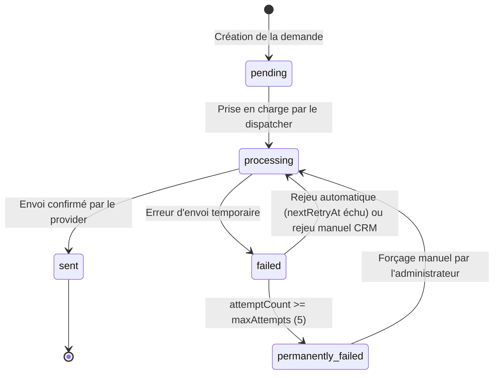

# Architecture du Système d'Email Transactionnel — SLAAC Voyages (Phase 01/12)

> **Date de rédaction :** 17 octobre 2026  
> **Branche Git :** `feat/slaac-transactional-emails`  
> **Statut :** Spécification technique & validation d'implémentation  
> **Auteur :** Architecte Logiciel Senior & DevOps  

---

## 1. Principes Directeurs d'Ingénierie

La conception du système de notification transactionnelle de **SLAAC Voyages** repose sur 5 piliers fondamentaux :

1. **Garantie Zéro Perte Commerciale (Lead First, Always) :**  
   L'enregistrement de la demande client dans Cloud Firestore constitue la source de vérité inviolable. Aucune anomalie d'envoi d'email (panne SMTP, clé révoquée, timeout réseau) ne doit interrompre ou annuler l'enregistrement d'un devis ou d'un message de contact.
2. **Pattern "Transactional Outbox" persistant :**  
   Chaque intention d'envoi est persistée dans une collection dédiée `emailOutbox` avec son statut de délivrabilité, permettant l'auditabilité et le rejeu automatique ou manuel.
3. **Idempotence Stricte :**  
   Chaque message possède une clé d'idempotence déterministe prévenant tout doublon d'envoi auprès du client ou de l'agence, même en cas de requêtes simultanées ou de rejeux réseau.
4. **Abstraction Multi-Fournisseur (Provider Agnostic) :**  
   Le système supporte de manière transparente les protocoles HTTP (SendGrid, Resend) et SMTP standard (LWS / Nodemailer), avec bascule automatique ou configuration dynamique, ainsi qu'un simulateur (Mock) pour les tests et la CI.
5. **Identité de Marque Haut de Gamme & Conformité Légale :**  
   Génération de templates HTML responsives conformes aux standards de l'hôtellerie et du voyage de luxe (charte Deep Navy & Matte Gold), assortis de mentions légales explicites protégeant l'agence.

---

## 2. Diagramme d'Architecture et Cycle de Vie

```mermaid
sequenceDiagram
    autonumber
    actor Client as Visiteur / Client
    participant API as Next.js API Route (/api/quotes, /api/contact)
    participant FS as Firestore (quotes, contacts)
    participant Outbox as Firestore (emailOutbox)
    participant Engine as Email Engine (src/lib/email)
    participant Provider as Email Provider (SendGrid / LWS SMTP / Resend)
    actor Agence as SLAAC Voyages (contact@ & Gmail)

    Client->>API: Soumission Formulaire
    API->>API: Validation Schéma Zod + Anti-Spam
    API->>FS: 1. Écriture Lead (Statut: pending, Référence: DV-XXXX)
    API->>Outbox: 2. Création Entrées Outbox (Client, Agence, Responsable)
    API-->>Client: 3. Réponse HTTP 200/201 Immédiate (Confirmation)
    
    rect rgb(10, 25, 47)
        Note over API,Engine: Dispatch Asynchrone / Non Bloquant
        API->>Engine: 4. Exécution Dispatch
        Engine->>Outbox: Mise à jour statut -> "processing"
        Engine->>Provider: 5. Envoi Message (HTML + Text)
        alt Succès Envoi
            Provider-->>Engine: 200 OK / Message ID
            Engine->>Outbox: Statut: "sent", sentAt: timestamp
            Engine->>FS: Mise à jour lead (emailStatus.recipient = "sent")
        else Échec Envoi (Timeout / Auth / Réseau)
            Provider-->>Engine: Erreur (4xx, 5xx, TCP Error)
            Engine->>Outbox: Statut: "failed", retryCount++, nextRetryAt: backoff
            Engine->>FS: Mise à jour lead (emailStatus.recipient = "failed")
        end
    end
    Provider-->>Client: Accusé de réception HTML (FR/EN)
    Provider-->>Agence: Notification Agence + Alerte Responsable
```



---

## 3. Schéma de Données de l'Outbox (`emailOutbox`)

Chaque notification est matérialisée par un document dans la collection `emailOutbox`. L'ID du document constitue la clé d'idempotence.

### 3.1. Structure de l'ID d'Idempotence
$$\text{DocumentID} = \text{collectionName} \ \_ \ \text{leadId} \ \_ \ \text{recipientType}$$

*Exemples réels :*
- `quotes_DV-20261017-8492_customer`
- `quotes_DV-20261017-8492_agency`
- `quotes_DV-20261017-8492_manager`
- `contacts_cnt_1729194820_customer`

### 3.2. Modèle de Document Firestore

```typescript
export type OutboxStatus = 'pending' | 'processing' | 'sent' | 'failed' | 'permanently_failed';

export interface EmailOutboxRecord {
  id: string; // Clé d'idempotence
  leadCollection: 'quotes' | 'contacts' | 'newsletter';
  leadId: string;
  recipientType: 'customer' | 'agency' | 'manager';
  to: string;
  from: string;
  replyTo?: string;
  subject: string;
  htmlBody: string;
  textBody: string;
  status: OutboxStatus;
  attemptCount: number;
  maxAttempts: number; // Défaut: 5
  nextRetryAt: FirebaseFirestore.Timestamp | null;
  lastAttemptAt: FirebaseFirestore.Timestamp | null;
  sentAt: FirebaseFirestore.Timestamp | null;
  lastError: string | null;
  providerUsed?: string;
  providerMessageId?: string;
  createdAt: FirebaseFirestore.Timestamp;
  updatedAt: FirebaseFirestore.Timestamp;
  metadata?: Record<string, unknown>;
}
```

---

## 4. Machine à États et Stratégie de Rejeu (Backoff Exponentiel)



### Algorithme de Calcul du Délai de Rejeu (Backoff avec Jitter)
Pour éviter un effet de tempête (*thundering herd*) sur les serveurs SMTP ou les APIs distantes, le délai de rejeu est calculé selon la formule :

$$\text{delaySeconds} = \min(3600, \text{baseDelay} \times 2^{(\text{attempt} - 1)}) + \text{jitter}$$

- **Tentative 1 :** 30 secondes ($\pm 5$ s).
- **Tentative 2 :** 2 minutes ($\pm 15$ s).
- **Tentative 3 :** 8 minutes ($\pm 30$ s).
- **Tentative 4 :** 30 minutes ($\pm 60$ s).
- **Tentative 5 :** 2 heures ($\pm 120$ s).
- **Au-delà de 5 tentatives :** Statut `permanently_failed`, intervention requise dans le CRM.

---

## 5. Abstraction des Fournisseurs d'Email (Multi-Provider)

L'architecture isole les détails d'implémentation derrière une interface unifiée :

```typescript
export interface SendEmailOptions {
  to: string | string[];
  from?: string;
  replyTo?: string;
  subject: string;
  html: string;
  text: string;
  headers?: Record<string, string>;
}

export interface EmailProviderResult {
  success: boolean;
  messageId?: string;
  provider: 'sendgrid' | 'resend' | 'smtp' | 'mock';
  error?: string;
  rawResponse?: unknown;
}

export interface EmailProvider {
  name: 'sendgrid' | 'resend' | 'smtp' | 'mock';
  send(options: SendEmailOptions): Promise<EmailProviderResult>;
}
```

### Fournisseurs Implémentés :
1. **SendGrid (`src/lib/email/providers/sendgrid.ts`) :**
   Appel direct à l'API REST v3 (`POST https://api.sendgrid.com/v3/mail/send`) via `fetch` natif Node.js.
2. **Resend (`src/lib/email/providers/resend.ts`) :**
   Appel direct à l'API REST (`POST https://api.resend.com/emails`) via `fetch` natif Node.js.
3. **SMTP LWS (`src/lib/email/providers/smtp.ts`) :**
   Client `nodemailer` configuré pour `mail.slaacvoyages.com` (Port 465 SSL ou 587 STARTTLS) avec timeout de connexion de 8 secondes pour respecter les contraintes serverless Vercel.
4. **Mock Provider (`src/lib/email/providers/mock.ts`) :**
   Capture en mémoire et journalisation structurée sans communication réseau. Utilisé automatiquement en l'absence de credentials ou en mode test.

---

## 6. Charte Graphique des Emails et Templates Responsives

### 6.1. Tokens de Design
- **Bleu Nuit Profond (Primary) :** `#0A192F`
- **Or Satiné Luxe (Accent) :** `#D4AF37`
- **Ivoire / Fond Léger (Background) :** `#F8F9FA`
- **Texte Principal :** `#1E293B`
- **Gris Bordure :** `#E2E8F0`
- **Typographie :** `-apple-system, BlinkMacSystemFont, 'Segoe UI', Roboto, Helvetica, Arial, sans-serif`

### 6.2. Matrice des Notifications

| Type de Flux | Destinataire | Objet (FR) | Spécificités & Actions |
| :--- | :--- | :--- | :--- |
| **Devis** | Client | `Accusé de réception de votre demande de devis — [DV-XXXX]` | Tableau récapitulatif complet, mention légale obligatoire, bouton d'appel direct. |
| **Devis** | Agence (`contact@`) | `NOUVEAU DEVIS [DV-XXXX] — Destination` | Actions rapides `tel:`, `mailto:`, lien direct CRM. |
| **Devis** | Manager (`mdslaacvoyages@gmail.com`) | `[ALERTE DIRECTION] Devis [DV-XXXX] — Destination` | Format allégé pour consultation mobile rapide. |
| **Contact** | Client | `Votre message a bien été reçu — SLAAC Voyages` | Confirmation de réception, rappel des canaux urgents. |
| **Contact** | Agence & Manager | `NOUVEAU MESSAGE CONTACT — Nom` | Message brut, coordonnées vérifiées, lien CRM. |
| **Newsletter** | Abonné | `Bienvenue dans l'univers SLAAC Voyages` | Message de bienvenue, lien de désinscription légal. |

### 6.3. Mentions Légales et Disclaimers Obligatoires
Dans tous les accusés de réception clients relatifs aux devis et séjours, l'encadré légal suivant est inséré de manière visible :

> **Information importante :**  
> *Le présent message constitue un accusé de réception confirmant la prise en charge de votre demande par nos conseillers spécialisés SLAAC Voyages. Il ne constitue en aucun cas une confirmation ferme de réservation ni une garantie d'obtention de visa ou de titre de transport. Nos équipes vous contacteront sous 24 à 48 heures ouvrées avec une proposition détaillée.*

---

## 7. Sécurité, RGPD et Robustesse Serverless

1. **Aucun Secret dans le Code Source ni dans les Logs :**  
   Les clés d'API et mots de passe SMTP ne sont jamais inscrits en dur ni affichés dans les traces applicatives. Les erreurs de dispatch sont nettoyées avant d'être persistées.
2. **Protection Anti-Spam en Amont :**  
   Conservation du Honeypot (`website`) et de la déduplication par hachage SHA-256 dans `/api/contact` pour éviter la saturation de l'outbox par des bots.
3. **Limitation de Débit (Rate Limiting) sur l'Administration :**  
   L'endpoint de rejeu manuel `/api/admin/leads/retry-email` est protégé par authentification Firebase Admin (`verifySessionCookie`) et vérifie le rôle administrateur.
4. **Timeouts Stricts :**  
   Chaque appel réseau de notification est borné par un timeout de 8 secondes (`AbortSignal`) pour garantir qu'aucune fonction Vercel ne dépasse son budget de temps d'exécution.
