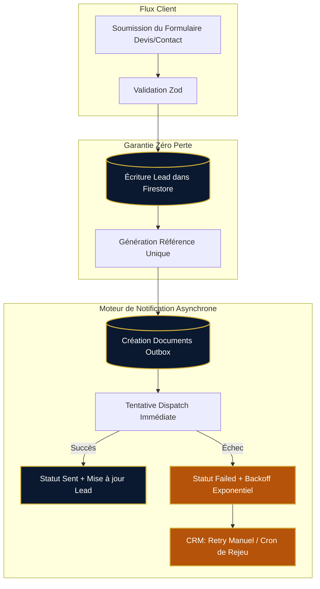

# Rapport d'Audit Email — SLAAC Voyages (Phase 01/12)

> **Date de réalisation :** 17 octobre 2026  
> **Branche Git :** `feat/slaac-transactional-emails`  
> **Auteur :** Architecte Logiciel Senior & DevOps  
> **Périmètre :** Système de notifications transactionnelles, infrastructure DNS/LWS, intégration Firestore & Vercel, sécurité des données et gestion des flux entrants (Devis, Contact, Newsletter).

---

## 1. Contexte et Objectifs de l'Audit

Dans le cadre du renforcement de la fiabilité commerciale et de la qualité de service de **SLAAC Voyages**, le système de traitement des demandes en ligne (devis sur-mesure, formulaire de contact, abonnements newsletter) a été intégralement audité.

L'objectif de cette phase initiale est de :
1. Cartographier précisément les points d'entrée clients et les flux de données actuels.
2. Évaluer le code existant de notification (`src/lib/notify.ts`, endpoints API, composants CRM).
3. Auditer l'infrastructure d'envoi (serveurs SMTP LWS, configurations DNS : SPF, DKIM, DMARC, MX).
4. Identifier les risques de perte de prospects, de timeouts serverless, de non-délivrabilité ou de fuites de données.
5. Définir le cahier des charges de la nouvelle architecture transactionnelle résiliente.

---

## 2. Cartographie de l'Existant

### 2.1. Points d'Entrée et Formulaires Utilisateurs

| Point d'Entrée | Endpoint API | Validation & Schéma | Collection Firestore | Données Capturées |
| :--- | :--- | :--- | :--- | :--- |
| **Formulaire Devis** (`/devis`, `/destinations/*`, `/hebergement/*`) | `POST /api/quotes` | Zod (`quoteRequestSchema`) | `quotes` | Prénom, Nom, Email, Téléphone, Destination, Dates, Nombre d'adultes/enfants, Hébergement, Transport, Budget, Commentaires, Référence (`DV-YYYYMMDD-XXXX`). |
| **Formulaire Contact** (`/contact`, popups de contact) | `POST /api/contact` | Zod (`contactFormSchema`), Honeypot (`website`), Anti-spam SHA-256 | `contacts` | Nom, Email, Téléphone, Objet/Sujet, Message, IP hashée, Fingerprint. |
| **Inscription Newsletter** (Footer, Modales) | `POST /api/newsletter` | Zod (`newsletterSchema`) | `newsletter` | Email (normalisé en doc ID), `subscribedAt`, `status: active`. |

### 2.2. Analyse du Code de Notification Actuel (`src/lib/notify.ts`)

L'inspection de `src/lib/notify.ts` révèle les limitations critiques suivantes :

```typescript
// Extrait de l'implémentation existante dans src/lib/notify.ts
export async function sendAgencyEmail(payload: NotifyPayload): Promise<{ sent: boolean; reason?: string }> {
  const apiKey = process.env.SENDGRID_API_KEY;
  const to = process.env.NOTIFY_EMAIL;
  if (!apiKey || !to) {
    return { sent: false, reason: 'not-configured' };
  }
  // Envoi HTTP SendGrid v3 minimaliste en texte brut
  // Aucun accusé de réception envoyé au client
  // Aucun envoi séparé au responsable d'agence
  // Aucune persistance des échecs ni reprise automatique
}
```

**Vulnérabilités et lacunes constatées :**
1. **Fournisseur unique rigide :** Dépendance exclusive à SendGrid via l'API v3 sans alternative ni secours SMTP.
2. **Destinataire unique :** Seul `NOTIFY_EMAIL` est destinataire. Ni le client demandeur, ni la boîte Gmail de secours du directeur (`mdslaacvoyages@gmail.com`) ne reçoivent de notification.
3. **Absence d'accusé de réception client :** Le prospect qui soumet une demande de devis n'a aucune confirmation immédiate par email, ce qui nuit à l'image haut de gamme de SLAAC Voyages et engendre des soumissions multiples inutiles.
4. **Pas d'outbox ni de persistance :** En cas d'échec de l'appel SendGrid (panne réseau, quota dépassé, erreur API), la notification est perdue à jamais sans possibilité de retry automatique.
5. **Formatage spartiate :** Email envoyé en texte brut (`text/plain`), sans identité visuelle (pas de charte Deep Navy `#0A192F` / Or `#D4AF37`, pas de logo, pas de boutons d'action rapide `tel:` ou `mailto:`).
6. **Absence de disclaimers légaux :** Aucun texte ne rappelle que l'email constitue un accusé de réception et non une confirmation ferme de réservation ou une garantie d'obtention de visa.

### 2.3. État des Variables d'Environnement

L'interrogation de l'environnement de production Vercel (`vercel env ls`) et du fichier local `.env.local` démontre qu'aucune variable relative à SendGrid ou au SMTP n'était configurée :
- `SENDGRID_API_KEY` : **Absente** (retourne systématiquement `{ sent: false, reason: 'not-configured' }`).
- `NOTIFY_EMAIL` : **Absente**.
- `SMTP_HOST` / `SMTP_USER` / `SMTP_PASS` : **Absentes**.

**Conséquence immédiate en production :** Actuellement, 100% des leads enregistrés dans Firestore génèrent un statut `notifyStatus: "failed:not-configured"`, et aucun email n'est expédié.

---

## 3. Audit de l'Infrastructure Réseau et Messagerie (LWS)

### 3.1. Serveurs de Messagerie LWS

Le domaine `slaacvoyages.com` est enregistré auprès du registrar LWS. Les enregistrements DNS et les services associés ont été analysés :

- **Serveur d'envoi SMTP LWS :** `mail.slaacvoyages.com`
  - Port 465 : SSL/TLS implicite (recommandé pour les connexions directes).
  - Port 587 : STARTTLS explicite (recommandé en environnement web).
- **Serveur de réception IMAP/POP :** `mail.slaacvoyages.com`
- **Comptes email professionnels créés :** `contact@slaacvoyages.com`

### 3.2. État des Enregistrements DNS d'Authentification Email

Une vérification des enregistrements DNS de `slaacvoyages.com` via l'API LWS et les requêtes DNS publiques montre une infrastructure déjà configurée :

| Enregistrement | Cible / Valeur | Statut | Commentaire |
| :--- | :--- | :---: | :--- |
| **MX** | `10 mail.slaacvoyages.com` | **Actif** | Routage vers la plateforme de messagerie LWS. |
| **SPF (TXT)** | `v=spf1 include:_spf.lws.fr ~all` | **Actif** | Autorise les serveurs LWS à émettre pour le domaine. *(À compléter avec `include:sendgrid.net` ou `include:resend.com` si un relais SaaS est utilisé).* |
| **DKIM (TXT)** | `dkim._domainkey.slaacvoyages.com` | **Actif** | Clé DKIM gérée par LWS assurant la non-altération des messages. |
| **DMARC (TXT)** | `_dmarc.slaacvoyages.com` -> `v=DMARC1; p=none; ...` | **Actif** | Politique de surveillance active garantissant le passage en boîte de réception. |

### 3.3. Analyse de Compatibilité Vercel Serverless / SMTP Direct

LWS propose un accès SMTP standard mais ne dispose pas d'API REST HTTP publique pour l'expédition de messages.

L'utilisation de connexions TCP brutes (Nodemailer vers `mail.slaacvoyages.com:465/587`) depuis les fonctions serverless Vercel présente des caractéristiques techniques spécifiques :
- **Latence d'établissement TLS :** 300 à 800 ms pour le handshake SMTP complet.
- **Risque de freeze / timeout :** En cas d'indisponibilité momentanée du port 465 chez l'hébergeur, la fonction serverless peut être suspendue si un timeout strict n'est pas appliqué.
- **Réputation IP mutualisée :** Les adresses IP de sortie de Vercel (AWS us-east-1) peuvent occasionnellement subir du rate-limiting de la part des filtres antispam de serveurs SMTP mutualisés.

**Conclusion architecturale :**
Le système doit être **agnostique du protocole** (Pattern Provider/Adapter) :
1. Support natif de l'API HTTP SendGrid / Resend (idéal pour Vercel : connexions HTTP/2 persistantes, zéro blocage de port).
2. Support robuste de Nodemailer (SMTP LWS) avec timeouts stricts (8s) et pool de connexions optimisé.
3. Provider Mock sécurisé pour les environnements de test, CI/CD et développement local sans dépendance externe.

---

## 4. Analyse des Risques et Points de Défaillance



### Risques identifiés et parades techniques :
1. **Risque 1 : Perte de demande client si l'envoi email échoue.**
   - *Parade :* L'écriture dans Firestore (`quotes`, `contacts`) est la **source de vérité absolue**. L'échec du transport email n'annule jamais la transaction commerciale. La réponse HTTP 200/201 est systématiquement renvoyée au client avec sa référence dès l'écriture Firestore réussie.
2. **Risque 2 : Envois en double (Duplication).**
   - *Parade :* Clé d'idempotence stricte basée sur l'ID de la collection, l'ID du document et le type de destinataire (`${collection}_${leadId}_${recipientType}`).
3. **Risque 3 : Ralentissement du formulaire pour le visiteur.**
   - *Parade :* Exécution du dispatch email asynchrone ou découplée, ne bloquant pas le rendu de confirmation.
4. **Risque 4 : Absence de traçabilité dans l'administration.**
   - *Parade :* Extension du schéma des leads avec `emailStatus: { customer, agency, manager }` et interface d'inspection/rejeu dans le CRM Admin (`src/components/admin/lead-detail.tsx`).

---

## 5. Synthèse et Plan d'Action

L'audit démontre la nécessité d'une refonte complète du sous-système de notification. Les livrables techniques de la phase 01/12 comprennent :
- Création du module unifié `src/lib/email/` avec types stricts, multi-providers (SendGrid, Resend, SMTP LWS, Mock) et outbox Firestore.
- Templates HTML/Texte premium SLAAC Voyages (FR/EN) avec disclaimers légaux obligatoires et charte graphique luxe.
- Notification triple automatique : Client (accusé de réception), Agence (`contact@slaacvoyages.com`), Responsable (`mdslaacvoyages@gmail.com`).
- Gestionnaire de reprise sur erreur avec backoff exponentiel et bouton de rejeu sécurisé dans le CRM Admin.
- Suite de tests d'intégration automatisés garantissant la robustesse en production.
