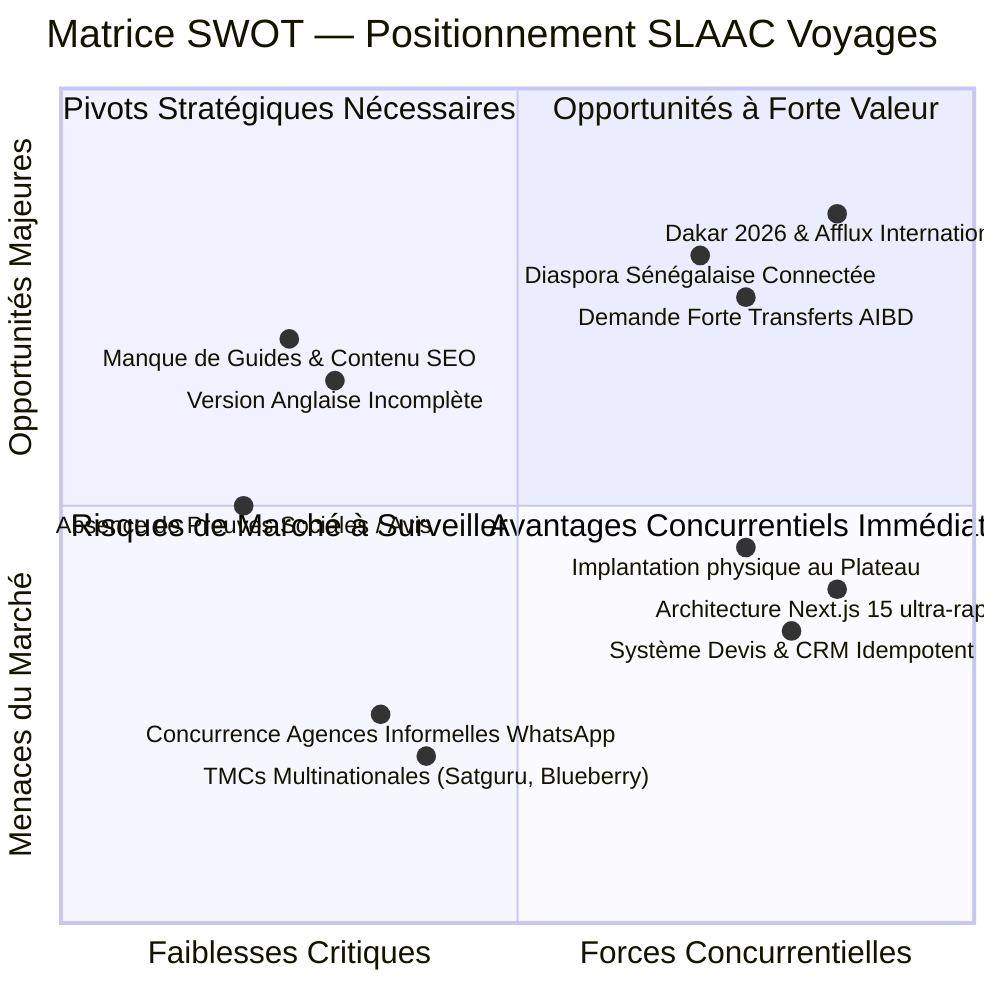

# RAPPORT 03/12 — DOCUMENT 01 : ÉTAT ACTUEL ET AUDIT STRATÉGIQUE DE SLAAC VOYAGES

> **Projet :** SLAAC Voyages (`https://slaacvoyages.com` / `https://slaac-voyages.vercel.app`)  
> **Date de l'audit :** 17 octobre 2026  
> **Branche Git :** `feat/slaac-market-benchmark` (dérivée de `feat/slaac-forms-crm`, commit `a9c980a`)  
> **Méthode :** Analyse du code source, inspection d'architecture, vérification des routes et des dépendances.

---

## 1. Cartographie de l'Architecture Technique Existante

### A. Stack Technologique (OBSERVÉ)
- **Framework Web :** Next.js 15.5.22 (App Router avec Server Components et Server Actions).
- **Langage & Typage :** TypeScript 5 strict, React 18.3.1.
- **Design System :** Tailwind CSS 3.4, shadcn/ui (Radix UI), Lucide Icons.
- **Backend & Données :**
  - Firebase Authentication (authentification administrateurs).
  - Cloud Firestore (collections : `quotes`, `contacts`, `newsletter`, `destinations`, `hebergements`, `transports`, `offresAffaires`, `excursions`, `voyagesCroisieres`, `emailOutbox`, `analytics`).
  - Firebase Admin SDK 12.0 côté serveur (API routes Node.js).
- **Médias :** Cloudinary SDK v2 pour l'optimisation et la distribution d'images CDN (`f_auto,q_auto`).
- **Hébergement & Infrastructure :** Vercel Serverless Platform, domaine principal configuré sur `slaacvoyages.com` (DNS LWS).
- **Messagerie Transactionnelle (Prompt 01) :** Pattern Outbox Firestore multi-fournisseur avec support SMTP LWS (`contact@slaacvoyages.com`), SendGrid, Resend et backoff exponentiel.
- **Formulaires & CRM (Prompt 02) :** Schémas Zod partagés (`quoteSchema`, `contactSchema`), idempotence double-clic par jeton client et empreinte SHA-256, écran de confirmation post-soumission avec référence de dossier `DV-YYYYMMDD-XXXX` et passerelle WhatsApp, priorisation CRM (`urgente`, `haute`, `normale`, `basse`), programmation de relance (`nextFollowUpAt`) et attribution UTM.

---

## 2. Inventaire de l'Offre Commerciale et des Parcours Utilisateurs

### A. Prestations Actuellement Présentées sur le Site
1. **Hébergements (`/hebergement`) :** Sélection d'hôtels et résidences à Dakar, Saly et à l'international, filtres par catégorie et ville, demande de devis contextualisée (nuits, type de chambre).
2. **Transports & Transferts (`/transport`) :** Transferts aéroport Blaise-Diagne (AIBD), trajets interurbains, location de véhicules avec chauffeur, vols internationaux.
3. **Voyages & Croisières (`/voyages-croisieres`) :** Forfaits séjours et croisières maritimes (Méditerranée, Caraïbes, Émirats).
4. **Excursions & Découverte (`/excursions`) :** Sorties guidées (Gorée, Lac Rose, Réserve de Bandia, Delta du Sine-Saloum, Casamance).
5. **Tourisme d'Affaires & MICE (`/tourisme-affaires`) :** Séminaires d'entreprises, incentives, congrès, délégations officielles et logistique d'événements professionnels.
6. **Assistance Voyage & Mobilité (`/assistance-voyage`) :**
   - Accompagnement démarches visas (constitution de dossier, prises de rendez-vous).
   - Assurance voyage internationale.
   - Préinscriptions universitaires pour étudiants sénégalais (France, Canada, Maroc).
   - Prise de rendez-vous en agence.
7. **Page Spéciale Événementielle (`/dakar-2026`) :**
   - Guide d'accueil pour le grand événement sportif international de fin 2026 à Dakar, Diamniadio et Saly (31 octobre – 13 novembre 2026).
   - Offres logistiques indépendantes : accueil AIBD, hébergement sur devis, véhicule avec chauffeur, navettes de groupes.
   - Mentions légales et disjonction d'affiliation respectées avec rigueur.
8. **Version Anglaise (`/en`) :**
   - Landing page dédiée en anglais présentant les compétences réceptives de l'agence pour les voyageurs anglophones, la diaspora et les entreprises.

---

## 3. Matrice SWOT de SLAAC Voyages

### Forces (Strengths) — OBSERVÉ
- **Excellence technologique :** Site bâti sur une stack moderne (Next.js 15 App Router, Vercel edge/serverless), temps de réponse rapide, 56 routes compilées sans erreur, aucun composant obsolète.
- **Fiabilité transactionnelle :** Double protection contre les pertes de leads (sauvegarde Firestore immédiate + Outbox résiliente pour emails multi-destinataires).
- **Expérience devis optimisée (Prompt 02) :** Formulaire adaptatif, référence de dossier avec bouton de copie, passerelle WhatsApp contextuelle, protection anti-spam par pot de miel.
- **Ancrage territorial vérifiable :** Agence physique établie au centre d'affaires de Dakar (Dakar Plateau, Rue Mouhamed 5, Immeuble Djolof Chicken, 3ème étage) avec ligne WhatsApp directe (+221 77 312 90 90).
- **Largeur du catalogue :** Capacité à couvrir l'ensemble du cycle de vie du voyage (incoming à Dakar, outgoing vers l'Europe/Asie, billetterie, assistance administrative).

### Faiblesses (Weaknesses) — OBSERVÉ
- **Déficit éditorial SEO :** Très peu d'articles de fond, de guides pratiques ou de FAQ fouillées sur les destinations spécifiques (ex. comment aller à Gorée, formalités du visa Schengen à Dakar, préparation du voyage d'affaires à Dubaï).
- **Internationalisation partielle :** Bien que `/en` existe pour la page d'accueil, les sous-pages de réservation, de circuits et de détail restent en français.
- **Preuve sociale non digitalisée :** Absence de témoignages clients certifiés ou d'intégration d'avis Google Maps sur le site web public.
- **Photos génériques :** Utilisation de banques d'images pour certaines illustrations de destinations plutôt que de photographies authentiques de l'équipe SLAAC Voyages et de ses véhicules.

### Opportunités (Opportunities) — INFÉRÉ
- **Événement Dakar 2026 :** Première compétition sportive olympique sur le continent africain, créant une vague inédite de délégations, journalistes, familles et supporters à la recherche d'opérateurs réceptifs fiables sur place.
- **Digitalisation de la clientèle locale et diaspora :** Forte pénétration de WhatsApp et des smartphones au Sénégal, permettant d'adopter une stratégie hybride "Site Web Rapide + WhatsApp Business".
- **Marché corporate intermédiaire (PME, consultants, ONG) :** Segment souvent négligé par les grandes TMCs (qui ciblent les multinationales) et mal servi par les agences traditionnelles de quartier.
- **Transparence sur les transferts AIBD :** Répondre à l'angoisse récurrente des voyageurs débarquant de nuit à l'aéroport avec une réservation claire, tarif fixe et accueil personnalisé.

### Menaces (Threats) — OBSERVÉ & INFÉRÉ
- **Concurrence informelle des intermédiaires non agréés :** Nombreux acteurs opérant uniquement sur TikTok et WhatsApp sans garantie légale, tirant les prix vers le bas au détriment de la qualité de service.
- **Poids des TMCs historiques :** Satguru Travel et Blueberry Travel bénéficient de contrats-cadres mondiaux et de volumes GDS importants pour les billets d'avion corporate.
- **Volatilité des politiques de visas :** Les exigences consulaires changeantes imposent une stricte prudence déontologique dans la communication commerciale (ne jamais garantir un visa).

---

## 4. Promesses Commerciales Nécessitant Clarification

Lors de cet audit, les points suivants ont été relevés et doivent être alignés avec la direction de SLAAC Voyages :
1. **Délai de réponse :** L'ancienne mention « devis sous 24h » a été neutralisée dans les formulaires récents au profit de « meilleurs délais ». La version anglaise (`/en`) contient encore deux occurrences textuelles statiques mentionnant « 24 h » qui devront être harmonisées lors du Prompt 04.
2. **Omra et pèlerinages :** Le service est demandé par la clientèle sénégalaise, mais SLAAC Voyages doit confirmer ses partenariats avec les agences agréées ou voyagistes saoudiens avant de publier des packages tarifés.
3. **Disponibilités hôtelières :** Le modèle actuel repose sainement sur la demande de devis et la confirmation manuelle ; il ne faut en aucun cas laisser croire à une disponibilité d'inventaire instantanée de type OTA.
