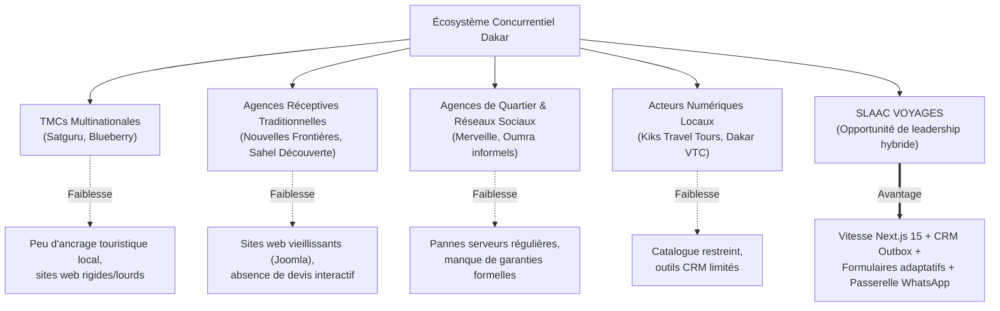

# RAPPORT 03/12 — DOCUMENT 13 : ÉTUDE COMPARATIVE ET BENCHMARK CONCURRENTIEL APPROFONDI

> **Périmètre :** Analyse comparative du marché des agences de voyages à Dakar et au Sénégal.  
> **Date des audits et observations réelles :** 17 octobre 2026.  
> **Méthode :** Inspection HTTP/HTML, audits de code source, vérification des balises sémantiques, tests de disponibilité et consultation des données publiques.  
> **Classification des informations :** **[OBSERVÉ]** (mesuré ou constaté en direct), **[INFÉRÉ]** (déduction logique étayée), **[NON VÉRIFIÉ]** (donnée nécessitant un accès privé non disponible).

---

## 1. Groupe 1 : Acteurs Reconnus et Agences Généralistes à Dakar

### 1.1. Satguru Travel Sénégal (`https://satgurutravel.com/senegal/`)
- **Présence locale [OBSERVÉ] :**
  - Siège : Ancienne Piste x Commissariat du Tourisme Lot 44 Mermoz Pyrotechnique, BP 48 117 Dakar.
  - Comptoir aéroportuaire : Bureau G-R10, Zone Arrivée, Terminal Principal AIBD.
  - Téléphones : `+221 33 860 66 02`, `+221 77 332 85 87`.
- **Positionnement [OBSERVÉ] :** Filiale d'un réseau multinational présent dans plus de 70 pays, axé sur la gestion des voyages d'affaires (Corporate Travel Management) et la billetterie grands comptes.
- **Architecture technique & Performance [OBSERVÉ] :**
  - Stack : WordPress 6.8 + Elementor + Rank Math SEO + Fluent Forms + WP Meteor.
  - Scripts bloquants : Forte surcharge de scripts JS (Mootools mock, jQuery, plugins multiples, CSS inline massifs de 270 Ko).
- **SEO & Contenus [OBSERVÉ] :**
  - Title : `Best Travel Agency Senegal | Satguru Travel` (en anglais sur la page dédiée au Sénégal).
  - Schema.org : `Article` et `TravelAgency` avec JSON-LD Rank Math.
  - Incohérence linguistique : Bien qu'implantée à Dakar où la langue de travail est le français, la page principale `/senegal/` est rédigée en anglais, créant une friction pour la clientèle locale.
- **Conversion & UX [OBSERVÉ] :**
  - Présence d'un formulaire Fluent Form et d'un bouton WhatsApp (`ht_ctc_main_css`).
  - L'expérience de devis reste générique et impersonnelle.

---

### 1.2. Blueberry Travel (`https://www.blueberry-travel.com/`)
- **Présence locale [OBSERVÉ] :**
  - Hub opérationnel Afrique & Moyen-Orient (siège social à Dubaï, téléphone `+971 4 770 7355`, fondé en 2013).
  - Référencé aux World Travel Awards comme leader du voyage d'affaires en Afrique.
- **Positionnement [OBSERVÉ] :** Pure Travel Management Company (TMC) pour les entreprises multinationales, le MICE et les voyages corporate complexes.
- **Architecture technique & Performance [OBSERVÉ] :**
  - Stack : Single Page Application (SPA) React compilée avec Bootstrap 5 et Webpack.
  - Hébergement : Microsoft Azure Blob Storage pour les médias (`blueberrydatastorage.blob.core.windows.net`).
- **Analyse critique pour le marché sénégalais [OBSERVÉ & INFÉRÉ] :**
  - Aucun point d'entrée spécifique pour les voyageurs individuels, touristes réceptifs ou voyageurs sénégalais.
  - Pas de page d'accueil dédiée à Dakar ou au Sénégal sur le domaine principal.
  - Concurrent indirect sur les très grands comptes institutionnels, mais quasi absent du parcours de recherche des PME locales et des touristes.

---

### 1.3. Nouvelles Frontières Sénégal (`https://nfsenegal.com/`)
- **Présence locale [OBSERVÉ] :** Agence réceptive (DMC) historique installée à Dakar depuis plus de 20 ans.
- **Positionnement [OBSERVÉ] :** Tourisme réceptif, séminaires, congrès, circuits de groupes et excursions au Sénégal.
- **Architecture technique & Performance [OBSERVÉ] :**
  - Stack : Joomla! 3.x (générateur visible dans les métadonnées).
  - Frameworks JS obsolètes : Mootools Core, jQuery Migrate, RokSprocket, scripts de 2014.
  - Absence de responsive moderne et de pré-rendu moderne.
- **SEO & Contenus [OBSERVÉ] :**
  - Title surchargé : `Nouvelles Frontières Sénégal - Agence receptive DMC, organisation d'événements sur Dakar et le Sénégal pour les entreprises - séminaire, congrès, réunions, Offres pour les Groupes et les individuels en Afrique de l'Ouest` (186 caractères, non optimisé pour les SERP Google modernes).
  - Présence de balises `meta keywords` bourrées de mots-clés (pratique SEO pénalisée ou ignorée par Google depuis des années).
- **Points forts concurrentiels [OBSERVÉ] :** Très forte notoriété institutionnelle sur les excursions classiques (Gorée, Lac Rose, Sine Saloum) et les réceptions de croisières à Dakar.

---

### 1.4. Merveille Voyage (`https://merveillevoyage.com/`)
- **Présence locale [OBSERVÉ] :**
  - Bureau principal : Mermoz-Sacré-Cœur, Dakar.
  - Antennes signalées : Saly/Mbour, Saint-Louis, Thiès, Touba.
  - Téléphones répertoriés : `+221 78 571 76 97` / `+221 78 010 04 78`.
- **Services répertoriés [OBSERVÉ] :** Billetterie aérienne GDS, forfaits séjours, assistance visas et passeports, mobilité internationale.
- **Incident Technique Majeur [OBSERVÉ LE 17/10/2026] :**
  - Lors de notre audit direct, l'URL `https://merveillevoyage.com/` retourne une **erreur HTTP 500 (Internal Server Error)**.
  - **Enseignement stratégique :** L'hébergement CMS non managé ou les serveurs locaux non monitorés constituent un talon d'Achille majeur chez les agences traditionnelles sénégalaises. Pendant toute la durée de la panne, 100 % des demandes digitales sont anéanties.

---

### 1.5. Kiks Travel Tours (`https://www.kikstravel.com/`)
- **Présence locale [OBSERVÉ] :**
  - Bureau : Nord Foire, Espace Ataya, Bâtiment 4, Appt. 412, Dakar.
  - Téléphone : `+221 33 824 42 46`.
  - Année de création : 2011.
- **Positionnement [OBSERVÉ] :** Agence généraliste moderne dakaroise : billetterie aérienne, Oumrah, voyages organisés, séjours sur mesure, assurances et transferts.
- **Architecture technique & Performance [OBSERVÉ] :**
  - Stack : HTML5 / CSS3 statique optimisé (`kiks.css?v=20261008a`), images WebP, polices Google préchargées (`Fraunces` et `Poppins`).
  - Données structurées : Excellente implémentation Schema.org JSON-LD `TravelAgency` avec coordonnées GPS (`14.6937, -17.4441`), horaires et `priceRange: "$$"`.
  - Traduction : Système bilingue dynamique léger via attributs `data-i18n`.
- **Évaluation :** C'est le concurrent local dont la structure front-end est la plus soignée parmi les agences locales de Dakar. Ses faiblesses résident dans l'absence de tunnel de devis interactif (simple formulaire de contact avec promesse statique « devis sous 24 h ouvrées ») et un catalogue d'hébergements peu digitalisé.

---

## 2. Groupe 2 : Concurrents Spécialisés au Sénégal

### 2.1. Transferts AIBD & VTC : Dakar VTC (`dakar-vtc.com`) & Taxi-AIBD (`taxi-aibd.com`) [OBSERVÉ]
- **Proposition de valeur :** Prise en charge à l'aéroport Blaise-Diagne avec tarif fixe (25 000 à 35 000 FCFA selon la berline), péage inclus, chauffeur avec pancarte nominative à la sortie bagages.
- **Canal de conversion dominant :** Click-to-WhatsApp immédiat avec message pré-rempli.

### 2.2. Excursions & Réceptif : Sahel Découverte (`saheldecouverte.com`) [OBSERVÉ]
- **Proposition de valeur :** Tour-opérateur spécialisé dans les circuits immersifs, l'ornithologie (Djoudj), les parcs naturels et les séjours culturels en Casamance et au Sine Saloum.

### 2.3. Excursions Journée : Lac Rose Tour Aventure (`lacrosetouraventure.com`) [OBSERVÉ]
- **Proposition de valeur :** Spécialiste des combinés d'une journée Gorée + Lac Rose (45 000 à 60 000 FCFA par personne), incluant les chaloupes, le guide officiel, le déjeuner et les balades en pirogue/quad dans les dunes.

### 2.4. Tourisme Religieux & Omra : Oumma Voyages Sénégal (`oummavoyages.sn`, Point E) & Dakar Makkah (`dakarmakkah.com`, Ouest Foire) [OBSERVÉ]
- **Proposition de valeur :** Spécialistes des forfaits Hajj et Omra (périodes vacances, Mawlid, Ramadan) avec sélection d'hôtels proches du Haram à La Mecque et Médine, encadrement religieux et assistance visa saoudien.

### 2.5. Tourisme d'Affaires & Événements : Africa Connection Tours [OBSERVÉ]
- **Proposition de valeur :** Agence réceptive d'affaires (Rue Félix Faure, Dakar) axée sur la logistique des délégations, la mise à disposition de flottes et les séminaires d'entreprises.

---

## 3. Groupe 3 : Benchmark International d'Inspiration

| Plateforme | Bonnes pratiques observables à transposer chez SLAAC Voyages |
| :--- | :--- |
| **Booking.com** | • Micro-copy rassurante permanente : « Annulation sans frais », « Aucun paiement requis maintenant ». • Récapitulatif clair des équipements inclus dans l'hébergement (climatisation, Wifi, petit-déjeuner). • Hiérarchie visuelle irréprochable sur mobile. |
| **Viator / GetYourGuide** | • Fiche excursion type « standard d'or » : durée précise, heure et lieu de rendez-vous, ce qui est inclus / non inclus. • Transparence des conditions d'accessibilité (enfants, personnes à mobilité réduite). • Bouton de devis ou contact direct avec formulaire simplifié en 2 étapes. |

---

## 4. Synthèse Comparative des Forces et Faiblesses

