# 03 — Architecture en Clusters Thématiques & Maillage Sémantique
**Projet :** SLAAC Voyages (`https://slaacvoyages.com`)  
**Phase :** Prompt 07/12 — Domination Éditoriale SEO, Pages de Services, Destinations & Stratégie de Contenus  
**Date :** 18 Octobre 2026  

---

## 1. Principes de la Topical Authority Touristique

Pour dominer les requêtes touristiques et de mobilité internationale à Dakar, le site ne doit pas se disperser en articles isolés. Chaque page doit appartenir à un **cluster thématique étanche et structuré** autour d'une **Page Pilier (Pillar Page)** commerciale, reliée à des **Contenus Satellites (Cluster Content & Guides Pratiques)**.

```mermaid
flowchart TD
    subgraph Cluster A ["Cluster A : Voyager depuis Dakar"]
        PilierA["/voyages-croisieres & /destinations"]
        SatA1["/destinations/dubai"]
        SatA2["/destinations/thailande"]
        GuideA["Guide : Billetterie & Vols long-courrier"]
        SatA1 --> PilierA
        SatA2 --> PilierA
        GuideA --> PilierA
    end

    subgraph Cluster B ["Cluster B : Découvrir le Sénégal"]
        PilierB["/excursions"]
        SatB1["/excursions/goree"]
        SatB2["/excursions/lac-rose"]
        SatB3["/excursions/bandia"]
        GuideB["Guide : Visiter l'île de Gorée en pratique"]
        SatB1 --> PilierB
        SatB2 --> PilierB
        SatB3 --> PilierB
        GuideB --> PilierB
    end

    subgraph Cluster C ["Cluster C : Arrivée & Séjour au Sénégal"]
        PilierC["/transport & /hebergement"]
        SatC1["Navette AIBD vers Dakar & Saly"]
        SatC2["Résidences meublées sécurisées Dakar"]
        GuideC1["Guide : Arrivée aéroport AIBD & navette"]
        GuideC2["Guide : Où loger à Dakar (Plateau vs Almadies)"]
        SatC1 --> PilierC
        SatC2 --> PilierC
        GuideC1 --> PilierC
        GuideC2 --> PilierC
    end

    subgraph Cluster D ["Cluster D : Assistance Visas & Formalités"]
        PilierD["/assistance-voyage"]
        SatD1["Assistance Visa Chine"]
        SatD2["Assurance Voyage Conforme Schengen"]
        GuideD["Guide : Démarches visa d'affaires Chine Dakar"]
        SatD1 --> PilierD
        SatD2 --> PilierD
        GuideD --> PilierD
    end

    subgraph Cluster E ["Cluster E : Omra depuis le Sénégal"]
        PilierE["/omra"]
        SatE1["Offre Séjour Omra (Vols & Hôtels)"]
        GuideE["Guide : Préparer son Omra (Nusuk & démarches)"]
        SatE1 --> PilierE
        GuideE --> PilierE
    end

    subgraph Cluster F ["Cluster F : Tourisme d'Affaires & MICE"]
        PilierF["/tourisme-affaires"]
        SatF1["Logistique Séminaires & Conférences Dakar"]
        SatF2["Accueil Délégations VIP & Transport"]
        SatF1 --> PilierF
        SatF2 --> PilierF
    end

    PilierA -.-> FormulaireDevis["Formulaire Devis Centralisé (CRM)"]
    PilierB -.-> FormulaireDevis
    PilierC -.-> FormulaireDevis
    PilierD -.-> FormulaireDevis
    PilierE -.-> FormulaireDevis
    PilierF -.-> FormulaireDevis
```

---

## 2. Définition Détaillée des 6 Clusters

### Cluster A : Voyager depuis le Sénégal (International)
- **Page Pilier :** `/voyages-croisieres` et hub `/destinations`
- **Rôle :** Inspirer et aiguiller le client vers les offres de séjours tout compris, circuits internationaux et croisières.
- **Satellites :** Fiches destinations régionales (Maroc, Égypte, Casamance) et mondiales (Dubaï, Paris, Bali, Bangkok).
- **CTA :** Demande de programme personnalisé sous 24 h.

### Cluster B : Tourisme Réceptif & Découverte du Sénégal
- **Page Pilier :** `/excursions`
- **Rôle :** Proposer des expériences locales authentiques encadrées par des chauffeurs et guides professionnels.
- **Satellites :** Fiches excursions phares (Gorée, Bandia Safari, Lac Rose & dunes, Delta du Saloum).
- **CTA :** Réservation d'excursion privée ou de groupe.

### Cluster C : Logistique d'Arrivée & Hébergements Clés en Main
- **Pages Piliers :** `/transport` et `/hebergement`
- **Rôle :** Rassurer immédiatement le voyageur sur sa prise en charge dès la descente d'avion et sur la qualité de son séjour.
- **Satellites :** Forfaits AIBD Dakar (30 000 - 35 000 FCFA), transferts Petite-Côte / Saly, appartements avec groupe électrogène & fibre garantie.
- **CTA :** Réservation navette aéroport / Demande de disponibilité hébergement.

### Cluster D : Assistance Administrative & Visas
- **Page Pilier :** `/assistance-voyage`
- **Rôle :** Accompagner les voyageurs dans la constitution rigoureuse de leurs dossiers sans fausses promesses.
- **Satellites :** Accompagnement Chine (affaires, foires), EAU/Dubaï, espace Schengen, attestations d'assurances 30 000 €.
- **CTA :** Évaluation personnalisée du dossier de visa avec un conseiller.

### Cluster E : Pèlerinage Omra
- **Page Pilier Dédiée :** `/omra`
- **Rôle :** Établir une relation de confiance spirituelle et logistique pour les fidèles sénégalais.
- **Satellites :** Hôtels vérifiés proches des lieux saints à Médine et La Mecque, coordination vols réguliers, assistance procédure Nusuk.
- **CTA :** Demande de programme Omra et devis accompagnement.

### Cluster F : Tourisme d'Affaires & MICE
- **Page Pilier :** `/tourisme-affaires`
- **Rôle :** Répondre aux exigences des comités d'entreprise, institutions et délégations bilatérales.
- **Satellites :** Transport de délégation, mise à disposition de flottes avec chauffeur, hébergements business, facturation avec TVA et contrat cadre.
- **CTA :** Demande de devis entreprise / Ouverture de compte corporate.

---

## 3. Règle d'Or du Maillage Interne
1. Chaque article de guide pratique doit comporter au moins **2 liens contextuels ascendants** vers sa page pilier de rattachement.
2. Les pages piliers comportent une section dédiée pointant vers les guides pratiques associés pour approfondir.
3. Aucun lien interne ne pointe vers une page inexistante, un brouillon ou une ancre générique (« cliquez ici »).
