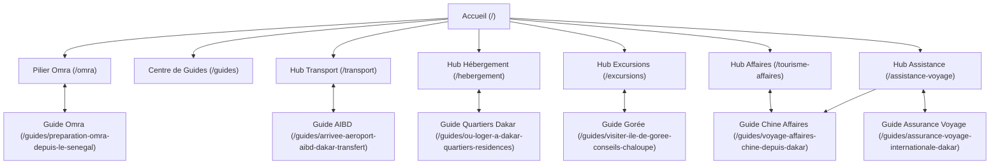

# Plan de Maillage Interne et Architecture en Silos (Topic Clusters)
## SLAAC Voyages | Maillage Sémantique & Distribution du PageRank Interne

---

### 1. Principes Directeurs du Maillage Interne

Le maillage interne de SLAAC Voyages a été entièrement refondu pour maximiser la transmission de jus de lien (PageRank interne) et créer des cocons sémantiques étanches et complémentaires :
1. **Verticalité des Silos (Topic Clusters) :** Les guides pratiques pointent prioritairement vers la page pilier ou la page de service correspondante.
2. **Liens Contextuels Ascendants :** Les pages de services (`/transport`, `/hebergement`, `/excursions`, `/tourisme-affaires`, `/assistance-voyage`) intègrent des encarts éditoriaux pointant vers leurs guides respectifs avec des ancres descriptives précises.
3. **Absence de liens d'ancres vagues :** Proscription des ancres non sémantiques comme « cliquez ici » ou « en savoir plus » au profit d'ancres riches (« Découvrir le guide pratique AIBD », « Comparatif des quartiers de Dakar », etc.).

---

### 2. Matrice de Maillage Croisé

---

### 3. Gestion du Fil d'Ariane (`BreadcrumbsList`)

Le composant `Breadcrumbs` est systématiquement déployé en tête de chaque page éditoriale et de service :
- Page d'accueil : Racine `https://slaacvoyages.com`.
- Niveau 1 : `/guides` ou `/omra`.
- Niveau 2 : `/guides/[slug]`.
Chaque étape génère une microdonnée JSON-LD `BreadcrumbList` valide, permettant à Google d'afficher les chemins de navigation enrichis dans les SERPs.
