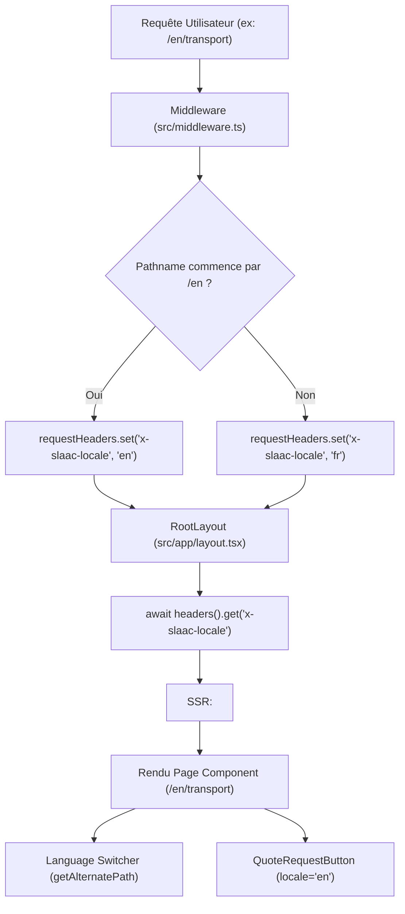

# Architecture Bilingue Français / Anglais
## SLAAC Voyages | Next.js 15 App Router & i18n Hybride

### 1. Principes Directeurs
L'architecture d'internationalisation de SLAAC Voyages a été conçue selon des principes stricts de performance, de préservation du SEO existant et de simplicité d'exploitation :
1. **Zéro régression d'URLs françaises** : la racine `/` et l'ensemble des URLs francophones historiques restent inchangées, indexées et conservent leur jus de lien acquis.
2. **Préfixe `/en` pour les URLs candidates anglaises** : toutes les pages destinées au public international sont logées sous `/en/*` (`/en`, `/en/transport`, `/en/hebergement`, `/en/excursions`, `/en/tourisme-affaires`, `/en/assistance-voyage`, `/en/destinations`, `/en/about`, `/en/contact`, `/en/dakar-2026`).
3. **Architecture hybride statique & dynamique** :
   - Pages de service et éditoriales sous forme de Server Components Next.js avec métadonnées optimisées et données Schema.org.
   - Formulaires interactifs client components (`use client`) avec gestion fine du state local et validation Zod synchronisée.
4. **Détection serveur et transmission en-têtes** :
   - Le middleware Next.js intercepte chaque requête, identifie le préfixe `/en` et injecte un en-tête `x-slaac-locale: 'en' | 'fr'`.
   - Le `RootLayout` (`src/app/layout.tsx`) lit cet en-tête de manière asynchrone pour injecter dynamiquement `<html lang={locale}>`.

### 2. Schéma Architectural du Flux i18n

### 3. Matrice de Répartition des Responsabilités
- `src/i18n/config.ts` : Constantes fondamentales (`locales = ['fr', 'en']`, `defaultLocale = 'fr'`).
- `src/i18n/routes.ts` : Table bi-directionnelle `ROUTE_PAIRS`, helpers de navigation `getAlternatePath`, `getHreflangAlternates`.
- `src/i18n/dictionaries/` : Dictionnaires JSON (`fr.json` et `en.json`) avec parité de clés à 100%.
- `src/components/layout/language-switcher.tsx` : Composant accessible de basculement de langue.
