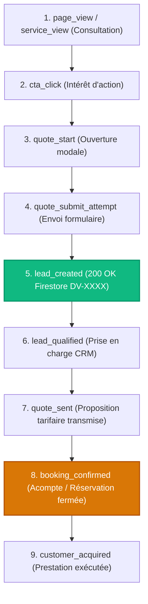

# Taxonomie Normalisée des Événements & Modèle de Conversion
## SLAAC Voyages | Phase 10/12 : Modèle Événementiel, Idempotence & Funnel Commercial

> **Date de publication :** 18 octobre 2026  
> **Auteurs :** Lead Growth Architect & Senior Analytics Engineer  
> **Fichier source de référence :** [`src/lib/tracking/events.ts`](file:///home/mouhammad/zahra-voyages/src/lib/tracking/events.ts)

---

## 1. Définition des 10 Échelons du Funnel de Conversion

L'erreur majeure du tracking digital consiste à comptabiliser de simples clics ou ouvertures de modale comme des « conversions » ou des « ventes ». Le modèle de SLAAC Voyages sépare distinctement les micro-engagements de navigation, la création effective de prospects (lead), et les étapes de closing commercial gérées au CRM.



### Échelon 1 : `page_view` & `service_view`
- **Déclenchement :** Chargement d'une route publique (`/`, `/transport`, `/hebergement`, etc.).
- **Nature :** Mesure de volume d'audience et de découvrabilité.
- **Règle :** Ne constitue en aucun cas une conversion commerciale.

### Échelon 2 : `cta_click`
- **Déclenchement :** Clic sur un bouton d'action principal (« Demander un devis », « Explorer les offres », « Voir les tarifs »).
- **Nature :** Micro-conversion d'intérêt intentionnel.
- **Paramètres :** `ctaLabel`, `ctaTarget`, `ctaLocation`.

### Échelon 3 : `whatsapp_click`
- **Déclenchement :** Clic sortant vers l'URL `wa.me/221773129090`.
- **Nature :** Intention de messagerie instantanée.
- **Règle capitale :** Le simple clic n'établit ni la réception effective du message par l'agence, ni l'envoi d'une demande complète. Ne doit pas être remonté comme conversion finale sans confirmation humaine ou webhook officiel.

### Échelon 4 : `quote_start`
- **Déclenchement :** Ouverture de la modale de devis (`QuoteRequestModal`) ou première interaction avec un formulaire dédié.
- **Nature :** Début de parcours de qualification.

### Échelon 5 : `quote_submit_attempt`
- **Déclenchement :** Clic sur le bouton de soumission du formulaire avant validation réseau.
- **Nature :** Tentative technique d'enregistrement. Si la validation Zod échoue ou que le réseau coupe, l'événement est archivé à des fins de diagnostic CRO mais ne crée aucun lead.

### Échelon 6 : `lead_created` (Le Pivot Commercial)
- **Déclenchement :** Réception par le navigateur du code HTTP 200 OK émis par `/api/quotes` ou `/api/contact` contenant la référence officielle (`reference: 'DV-20261018-XXXX'`).
- **Nature :** **La conversion d'acquisition officielle.**
- **Canaux notifiés :** GA4 (`generate_lead`), Meta Pixel (`Lead`), TikTok Pixel (`SubmitForm`), Firestore.

### Échelons 7 à 10 : Événements CRM Hors-Ligne (Server-Side)
- **`lead_qualified` :** Le conseiller clientèle valide que la demande correspond à un besoin réel avec coordonnées valides.
- **`quote_sent` :** Une cotation personnalisée détaillée est transmise au voyageur.
- **`booking_confirmed` :** La réservation est actée (paiement d'acompte ou validation bon de commande corporate).
- **`customer_acquired` :** La prestation a été effectuée et facturée.

---

## 2. Déduplication & Génération Déterministe d'Event ID

Pour réconcilier les événements émis par le navigateur (client-side) avec les événements futurs transmis par serveur (Meta Conversions API, TikTok Events API, Google Enhanced Conversions), un identifiant déterministe est généré via la fonction [`buildEventId`](file:///home/mouhammad/zahra-voyages/src/lib/tracking/events.ts) :

```typescript
export function buildEventId(eventName: string, uniqueContext?: string): string {
  const prefix = eventName.toLowerCase().replace(/[^a-z0-9]/g, '_');
  const context = uniqueContext ? `_${uniqueContext}` : '';
  const rand = Math.random().toString(36).substring(2, 10);
  const time = Date.now().toString(36);
  return `slaac_${prefix}${context}_${time}_${rand}`;
}
```

Pour l'événement `lead_created`, le contexte unique transmis est directement la référence du devis (ex: `DV-20261018-4821`), assurant que toute réconciliation serveur déduplique rigoureusement le prospect sans gonfler artificiellement les résultats publicitaires.
