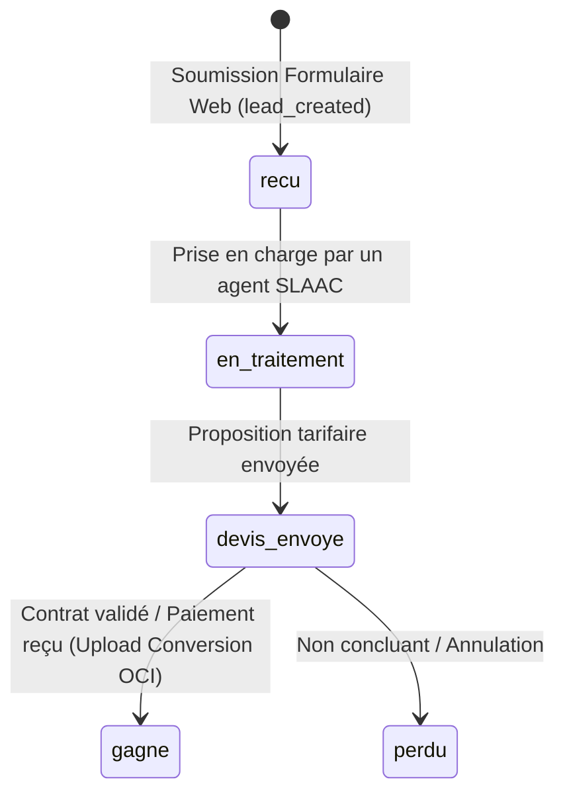

# 07. Suivi des Conversions Hors-Ligne Google Ads et Data Manager
**SLAAC Voyages | Réconciliation CRM Firestore, Enchères à la Valeur & Enhanced Conversions**

---

## 1. Justification Métier et Objectif Stratégique

Dans le secteur du voyage sur mesure et de la billetterie, la conversion finale (paiement du billet, réservation du transfert, signature du contrat voyage d'affaires) s'effectue après un échange humain (téléphone, email, WhatsApp, ou passage en agence).

Le simple événement web `lead_created` n'indique pas la valeur réelle générée. L'import des **conversions hors ligne (Offline Conversion Tracking - OCT)** et l'utilisation de **Google Ads Data Manager** permettent :
1. De transmettre à l'algorithme Google Ads Smart Bidding la valeur monétaire réelle (FCFA) encaissée.
2. D'optimiser pour le ROAS (Retour sur Dépense Publicitaire) plutôt que pour le volume brut de formulaires.
3. De disqualifier les faux leads ou spams dans l'apprentissage automatique des enchères.

---

## 2. Cycle de Vie d'un Lead dans le CRM Firestore

Chaque devis enregistré dans `quotes/{quoteId}` ou contact dans `contacts/{contactId}` traverse les états :



---

## 3. Données Clés Nécessaires pour l'Upload OCI

Pour chaque lead qualifié ou gagné, SLAAC Voyages conserve dans Firestore les attributs de rapprochement :

| Paramètre Firestore | Source | Format Google Ads OCI |
| :--- | :--- | :--- |
| `gclid` | URL Click ID (Web classique) | `Google Click ID` |
| `gbraid` / `wbraid` | Clics sur apps / Safari iOS | `GBRAID / WBRAID` |
| `email` | Saisie client | Haché en SHA-256 (`user_identifiers.hashed_email`) |
| `telephone` | Saisie client (+221...) | Haché en SHA-256 (`user_identifiers.hashed_phone_number` au format E.164) |
| `conversionTime` | Horodatage validation vente | `yyyy-mm-dd hh:mm:ss+zz:zz` (ex: `2026-10-18 14:30:00+00:00`) |
| `conversionName` | Action Google Ads | `Lead_Qualifie` ou `Devis_Signe_Gagne` |
| `conversionValue` | Montant vente final | Valeur en FCFA (ex: `35000` pour AIBD, `850000` pour billet long-courrier) |
| `conversionCurrency` | Devise transaction | `XOF` |

---

## 4. Spécification Technique de l'Export / Import

### 4.1 Format Fichier CSV Google Ads Data Manager / Conversion Upload

Un export périodique (journalier ou hebdomadaire) peut être uploadé dans Google Ads via **Objectifs > Conversions > Importations** :

```csv
Parameters:TimeZone=Africa/Dakar
Google_Click_ID,Conversion_Name,Conversion_Time,Conversion_Value,Conversion_Currency,Order_ID
EAIaIQobChMIr...,Devis_Signe_Gagne,2026-10-18 15:30:00,35000,XOF,DV-20261018-0012
EAIaIQobChMIx...,Devis_Signe_Gagne,2026-10-18 17:15:00,850000,XOF,DV-20261018-0015
```

### 4.2 Script Cloud Function / API Automatisé (Architecture Future)

```typescript
// Architecture logique pour l'import programmatique Google Ads API
import { GoogleAdsApi } from 'google-ads-api';
import { createHash } from 'crypto';

function hashData(input: string): string {
  return createHash('sha256').update(input.trim().toLowerCase()).digest('hex');
}

export async function uploadOfflineConversion(quote: {
  gclid?: string;
  email: string;
  phone: string;
  wonAt: Date;
  finalAmount: number;
  orderId: string;
}) {
  const conversionPayload = {
    conversion_action: 'customers/XXX/conversionActions/YYY',
    conversion_date_time: quote.wonAt.toISOString().replace('T', ' ').substring(0, 19) + '+00:00',
    conversion_value: quote.finalAmount,
    currency_code: 'XOF',
    order_id: quote.orderId,
    ...(quote.gclid ? { gclid: quote.gclid } : {
      user_identifiers: [
        { hashed_email: hashData(quote.email) },
        { hashed_phone_number: hashData(quote.phone) }
      ]
    })
  };
  // Envoi sécurisé via Google Ads API
}
```

---

## 5. Règles de Confidentialité et Protection des Données

1. Les données d'identification (`email`, `phone`) sont systématiquement hachées en mémoire avant transmission.
2. Aucune donnée relative aux notes confidentielles ou aux cartes bancaires n'est transmise.
3. Seuls les statuts validés administrativement (`gagne`) déclenchent l'envoi de la valeur monétaire, évitant toute surestimation des algorithmes d'enchères.
