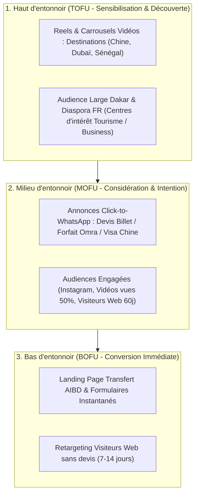

# 08. Stratégie Meta Ads (Facebook & Instagram)
**SLAAC Voyages | Social Acquisition, Notoriété Locale et Campagnes Click-to-WhatsApp**

---

## 1. Rôle de Meta dans l'Écosystème SLAAC

Alors que Google Ads Search capte l'intention active, Meta Ads (Facebook et Instagram) permet de :
1. **Créer le besoin et inspirer :** Valoriser les destinations, la flotte de véhicules confortables, et la simplicité des démarches avec SLAAC Voyages.
2. **Engager la communauté locale dakaroise :** Le Sénégal compte une adoption massive de Facebook et Instagram, particulièrement sur mobile.
3. **Générer des conversions directes WhatsApp :** Le format *Click-to-WhatsApp* permet d'établir une conversation humaine immédiate avec un conseiller SLAAC en agence à Dakar.

---

## 2. Structure du Compte en Entonnoir (Full-Funnel)

---

## 3. Découpage des Campagnes et Audiences Cibles

### Campagne 1 : `SN_META_CONV_AIBD-CHAUFFEUR`
- **Objectif Meta :** Leads (Formulaire de conversion sur Landing Page `/lp/transfert-aibd` ou Leads Instantanés).
- **Cible :** Dakar (rayon 40 km) + Voyageurs fréquents internationaux + Expatriés résidant à Dakar.
- **Angle Créatif :** Rassurer sur la fiabilité, la climatisation, la ponctualité et la prise en charge à la sortie de l'AIBD avec panneau.

### Campagne 2 : `SN_META_MSG_WHATSAPP-SERVICES`
- **Objectif Meta :** Messages (Démarrer une conversation WhatsApp Business).
- **Cible :** Hommes et femmes 25-60 ans, Dakar, centres d'intérêt "Commerce international", "Import-Export", "Foire de Canton", "Billet d'avion".
- **Angle Créatif :** « Besoin d'un visa pour la Chine ou Dubaï ? Discutez en direct avec un expert SLAAC à Dakar ».

### Campagne 3 : `SN_META_REENG_RETARGETING-SITE`
- **Objectif Meta :** Conversion devis.
- **Cible :** Visiteurs du site web des 30 derniers jours (excluant les personnes ayant déjà généré `lead_created`).
- **Angle Créatif :** « Vous avez consulté nos offres de voyage ? Finalisez votre demande de devis en 2 minutes avec notre équipe ».

---

## 4. Angles Rédactionnels et Concepts Créatifs

### Concept 1 : Le Transfert AIBD Sérénité (Vidéo 9:16 Reel / Story)
- **Accroche visuelle (Hook) :** « Pourquoi négocier un taxi à Diass à 2h du matin ? »
- **Visuel :** Chauffeur en tenue soignée ouvrant la portière d'une berline climatisée avec bouteille d'eau fraîche, panneau d'accueil nominatif à la sortie bagages.
- **Message :** « Réservez votre transfert AIBD Dakar avec SLAAC Voyages. Tarif fixe dès 35 000 FCFA, suivi de votre vol en temps réel, zéro attente. Cliquez ci-dessous pour réserver. »
- **Bouton d'action :** Réserver maintenant.

### Concept 2 : Visa Chine & Canton Express (Carrousel Instagram / Facebook)
- **Slide 1 :** « Voyage d'affaires en Chine : Ne laissez pas un refus de visa bloquer vos opportunités ».
- **Slide 2 :** « Dossier vérifié de A à Z par nos spécialistes visas à Dakar ».
- **Slide 3 :** « Accompagnement billetterie, hôtel et transfert sur place ».
- **Slide 4 (CTA) :** « Contactez notre agence dès aujourd'hui sur WhatsApp ».

### Concept 3 : Omra Confort & Proximité (Post Feed / Reel)
- **Accroche :** « Accomplissez votre Omra l'esprit totalement libéré ».
- **Contenu :** Présentation des hôtels proches du Haram à La Mecque et Médine, accompagnement religieux et encadrement sénégalais dévoué.
- **Bouton d'action :** Envoyer un message WhatsApp.

---

## 5. Bonnes Pratiques d'Exécution et Paramétrage

1. **Placements Advantage+ :** Diffusion recommandée sur Feed Facebook, Feed Instagram, Stories et Reels pour maximiser la portée au coût par résultat le plus faible.
2. **Fréquence Maximale :** Plafonnement à 3-4 impressions par utilisateur par semaine pour éviter l'usure de l'audience locale dakaroise.
3. **Renouvellement Créatif :** Rotation des formats tous les 21 jours pour maintenir le taux de clics (CTR > 1.8%).
