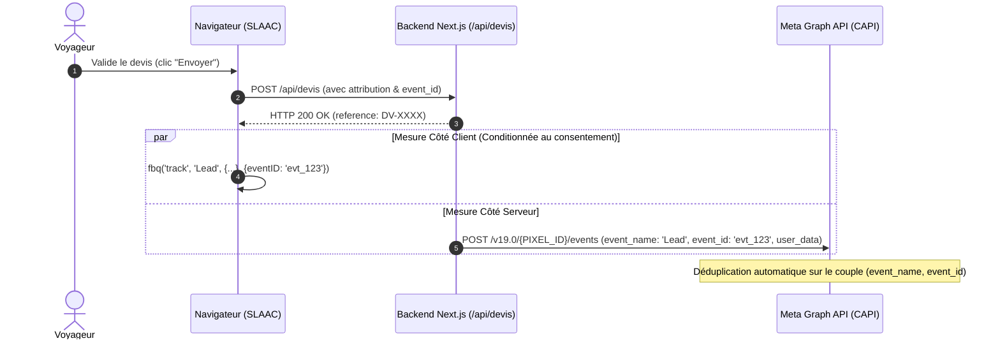

# 09. Meta Pixel et Conversions API (CAPI) : Architecture et Déduplication
**SLAAC Voyages | Suivi Hybride Navigateur-Serveur Haute Résilience**

---

## 1. Principes de la Mesure Hybride Meta

Avec la perte de signaux côté navigateur (bloqueurs de publicité, restrictions Safari ITP, modes de navigation privée), la mesure publicitaire Meta repose sur une architecture combinée :
1. **Événements Côté Navigateur (Meta Pixel - `fbq`) :** Captent les signaux directs d'interaction et déposent les cookies first-party `_fbp` et `_fbc`.
2. **Événements Côté Serveur (Conversions API - CAPI) :** Transmis depuis le backend Next.js / Cloud Function directement aux serveurs Meta via HTTPS.



---

## 2. Déduplication Déterministe Côté Client et Serveur

Pour empêcher la comptabilisation en double d'une conversion lorsque les deux canaux émettent l'événement, Meta requiert deux clés concordantes :
- **`event_name` :** Identique (ex: `'Lead'`).
- **`event_id` :** Identifiant unique déterministe généré au moment de l'événement.

### Implémentation SLAAC Voyages

Dans [src/lib/tracking/events.ts](file:///home/mouhammad/zahra-voyages/src/lib/tracking/events.ts) :
```typescript
export function buildEventId(eventName: string, reference?: string): string {
  const base = reference ? reference.replace(/[^a-zA-Z0-9]/g, '') : Math.random().toString(36).substring(2, 10);
  return `evt_${Date.now()}_${eventName.substring(0, 4)}_${base}`;
}
```

Dans [src/lib/tracking/provider.ts](file:///home/mouhammad/zahra-voyages/src/lib/tracking/provider.ts) :
```typescript
if (typeof window.fbq === 'function') {
  window.fbq('track', 'Lead', {
    content_name: event.service || 'general',
    currency: event.currency || 'XOF',
    value: event.value || 0
  }, { eventID: event.event_id });
}
```

---

## 3. Paramètres Utilisateur CAPI (Customer Information Parameters)

Pour maximiser le **Score de Correspondance de Qualité des Événements (Event Quality Match Score - EMQ > 8.0/10)**, le serveur transmet les identifiants normalisés et hachés en SHA-256 :

| Paramètre CAPI | Normalisation Requise | Exemple Avant Hachage | Format Envoyé |
| :--- | :--- | :--- | :--- |
| `em` | Minuscules, sans espaces | `client@slaacvoyages.com` | `SHA256(client@slaacvoyages.com)` |
| `ph` | Format international E.164, sans symboles | `+221 77 123 45 67` -> `221771234567` | `SHA256(221771234567)` |
| `fn` / `ln` | Prénom / Nom minuscules | `mouhammad` / `diop` | `SHA256(...)` |
| `ct` | Ville en minuscules | `dakar` | `SHA256(dakar)` |
| `country` | Code pays ISO 2 lettres en minuscules | `sn` | `SHA256(sn)` |
| `client_user_agent` | En-tête HTTP User-Agent brut | Reçu du navigateur | Texte brut |
| `client_ip_address` | Adresse IPv4 ou IPv6 | Reçue du header `x-forwarded-for` | Texte brut |
| `fbp` | Valeur du cookie `_fbp` | `fb.1.1712345678.123456789` | Texte brut |
| `fbc` | Cookie `_fbc` ou généré via `fbclid` | `fb.1.1712345678.IwAR...` | Texte brut |

---

## 4. Respect du Consentement et Mode Diagnostic

1. **Bloquage par Défaut :** Le Pixel Meta n'est initialisé et n'émet aucun appel réseau tant que l'utilisateur n'a pas validé les cookies publicitaires (`marketing: true` / `ad_storage: 'granted'`).
2. **Code de Test CAPI (Test Event Code) :** Lors des tests de pré-production ou de recette, le champ `test_event_code: 'TEST12345'` est transmis pour visualiser les réconciliations en temps réel dans le Gestionnaire d'Événements Meta sans contaminer les données de production.
