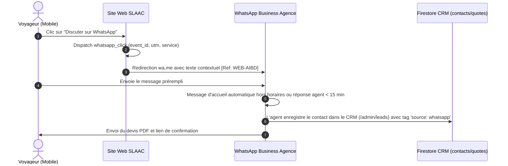

# 12. Stratégie de Conversion WhatsApp Business
**SLAAC Voyages | Conversational Marketing, Préremplissage Contextuel et Intégration CRM**

---

## 1. Rôle Central de WhatsApp au Sénégal

Au Sénégal, WhatsApp n'est pas un simple canal de messagerie : c'est le **premier canal de clôture commerciale**. 
La majorité des voyageurs, familles et commerçants dakarois préfèrent échanger des notes vocales, poser des questions instantanées et recevoir leurs devis ou billets d'avion par WhatsApp plutôt que par email.

SLAAC Voyages positionne WhatsApp comme un canal de conversion à part entière, mesuré et relié au CRM.

---

## 2. Architecture de Traçabilité des Clics WhatsApp

Chaque bouton WhatsApp sur le site (`Header`, `Footer`, `Landing Pages`, `Boutons Flottants`) déclenche l'événement analytique unifié `whatsapp_click` :

```typescript
trackConversionEvent('whatsapp_click', {
  service: 'transfert-aeroport',
  cta_text: 'Réserver via WhatsApp',
  landing_page: window.location.pathname,
  source: 'web_lp'
});
```

### Format des Messages Préremplis Contextuels

Pour identifier immédiatement le service et la provenance du lead lors de l'ouverture du chat, l'URL WhatsApp `https://wa.me/221XXXXXXXX` intègre un message encodé personnalisé :

| Page d'Origine | Message Prérempli WhatsApp |
| :--- | :--- |
| `/lp/transfert-aibd` | *« Bonjour SLAAC Voyages, je souhaite réserver un transfert AIBD privé. Pouvez-vous me confirmer vos disponibilités ? [Ref: WEB-AIBD] »* |
| `/services/visa` | *« Bonjour SLAAC Voyages, j'aimerais des renseignements pour une assistance visa (Chine / Dubaï / Asie). [Ref: WEB-VISA] »* |
| `/services/billetterie` | *« Bonjour SLAAC Voyages, je recherche un billet d'avion au départ de Dakar. Voici mes dates souhaitées : [Ref: WEB-VOL] »* |
| `/services/omra` | *« Salam alaykoum SLAAC Voyages, je souhaite recevoir les informations et tarifs pour vos forfaits Omra. [Ref: WEB-OMRA] »* |
| `/en/lp/transfert-aibd` | *« Hello SLAAC Voyages, I would like to book a private AIBD airport transfer to Dakar. [Ref: EN-AIBD] »* |

---

## 3. Parcours d'Intégration et Traitement dans le CRM



---

## 4. Réponses Automatiques et Modèles de Messages (Templates WhatsApp)

### 4.1 Message d'Accueil Immédiat (Auto-Reply 24/7)
> *« Bonjour et bienvenue chez SLAAC Voyages Dakar ! ✈️
> Nous avons bien reçu votre demande concernant nos services.
> Un conseiller dédié de notre agence prend en charge votre message et vous répond dans les prochaines minutes.
> 📍 Agence : Dakar, Sénégal | 🕒 Horaires : Lun-Sam 08h30 - 19h00 (Urgences vols & transferts 24/7). »*

### 4.2 Message Hors-Horaires d'Ouverture
> *« Bonsoir ! Notre agence physique est actuellement fermée, mais votre message est bien enregistré. Pour les transferts AIBD urgents de cette nuit, notre régulateur d'astreinte vous répond sous peu. Pour les autres demandes, nous revenons vers vous dès 08h30. Merci de votre confiance ! »*

---

## 5. Mesure des Conversions Click-to-WhatsApp Meta Ads

Dans le cadre des campagnes Meta Ads :
- L'objectif `MESSAGES` optimise la diffusion vers les personnes ayant la plus forte probabilité d'envoyer un message via WhatsApp.
- Les conversions sont attribuées à la campagne spécifique grâce au code de suivi inséré automatiquement dans le message ou via l'API WhatsApp Cloud.
