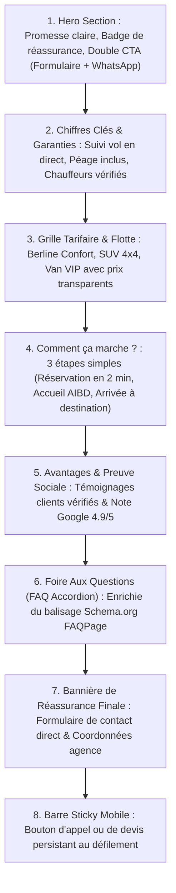

# 13. Plan Stratégique des Landing Pages Dédiées (PPC / Paid Social)
**SLAAC Voyages | Architecture de Conversion, Expérience Mobile-First et LPs Spécialisées**

---

## 1. Raison d'Être des Landing Pages Dédiées

Envoyer le trafic payant (Google Ads, Meta, TikTok) vers la page d'accueil générale (`/`) entraîne des taux de rebond élevés (> 65%) et une dilution de l'intention.
Une landing page dédiée présente un **taux de conversion moyen 3 à 5 fois supérieur** grâce à :
1. Une correspondance exacte entre la promesse de l'annonce et le titre de la page (Message Match).
2. La suppression de la navigation distrayante (pas de menus tentaculaires).
3. Une hiérarchie claire orientée vers un double objectif de conversion : Devis direct ou Discussion WhatsApp immédiate.
4. Une vitesse de chargement instantanée sur mobile (Core Web Vitals optimisés).

---

## 2. Anatomie d'une Landing Page Haute Performance SLAAC

Chaque landing page développée respecte une structure en 8 blocs éprouvée (mise en œuvre sur `/lp/transfert-aibd`) :

---

## 3. Matrice des Landing Pages en Production et Planifiées

| URL Landing Page | Version EN | Service Cible | Canaux d'Acquisition Privilégiés | Statut |
| :--- | :--- | :--- | :--- | :--- |
| `/lp/transfert-aibd` | `/en/lp/transfert-aibd` | Navette & Chauffeur AIBD Dakar | Google Ads Search, Meta Reels, TikTok Ads | **Déployé & Testé** |
| `/lp/visa-chine-canton` | `/en/lp/china-business-visa` | Visa Affaires & Foire de Canton | Meta Ads (Commerçants), Google Search | Phase 2 |
| `/lp/omra-senegal` | Non requis (FR/Wolof) | Forfaits Omra Confort & VIP | Meta Ads, WhatsApp Direct, Google Search | Phase 2 |
| `/lp/voyages-affaires` | `/en/lp/corporate-travel` | Billetterie Entreprises & B2B | LinkedIn Ads, Google Search B2B | Phase 3 |
| `/lp/dakar-2026-sejour` | `/en/lp/dakar-2026-travel` | Réceptif Dakar 2026 (JOJ) | Google Ads International, Meta Diaspora | Phase 3 |

---

## 4. Détail de la Landing Page Déployée : `/lp/transfert-aibd`

- **Fichiers Source :** [src/app/lp/transfert-aibd/page.tsx](file:///home/mouhammad/zahra-voyages/src/app/lp/transfert-aibd/page.tsx) et [src/app/en/lp/transfert-aibd/page.tsx](file:///home/mouhammad/zahra-voyages/src/app/en/lp/transfert-aibd/page.tsx).
- **Tarification Annoncée en Transparence :**
  - Berline Confort (1-3 passagers) : `35 000 FCFA` (Dakar Centre / Almadies).
  - SUV Prestige 4x4 (1-4 passagers) : `50 000 FCFA`.
  - Van VIP / Minibus (jusqu'à 8 passagers) : `75 000 FCFA`.
- **Inclusions Explicites :** Péage autoroute à péage compris, attente gratuite de 60 min en cas de retard de vol, bouteille d'eau fraîche, assistance bagages.
- **Micro-données JSON-LD :** Balises `Product`, `LocalBusiness`, et `FAQPage` intégrées pour un référencement organique complémentaire.
