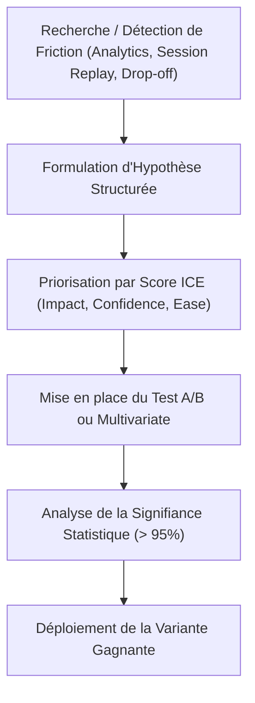

# 14. Programme d'Expérimentation et Optimisation des Conversions (CRO)
**SLAAC Voyages | Réduction des Frictions, A/B Testing et Psychologie de Conversion**

---

## 1. Cadre Méthodologique CRO

Le programme CRO de SLAAC Voyages vise à maximiser le rendement de chaque visiteur qualifié acquis via les leviers payants et organiques.
L'approche repose sur le modèle **LIFT (Land, Intent, Friction, Trust)** adapté aux spécificités de la clientèle dakaroise et internationale.

---

## 2. Feuille de Route des 5 Expérimentations Prioritaires

### Test 1 : Nombre de Champs et Modalité de Saisie Formulaire Devis
- **Hypothèse :** Réduire les champs requis au premier contact (uniquement Nom, Téléphone WhatsApp, et Destination) augmentera le taux de soumission de +25%.
- **Variante A (Contrôle) :** Formulaire complet avec date de départ, retour, nombre de passagers, classe, budget.
- **Variante B (Challenger) :** Micro-formulaire « Rappel express sous 15 min » avec qualification différée par l'agent SLAAC.
- **Métrique Clé :** Taux de conversion formulaire (`quote_start` -> `lead_created`).
- **Score ICE :** Impact: 8/10, Confiance: 9/10, Facilité: 8/10 = **Score ICE: 8.3**.

### Test 2 : Hiérarchie CTA Mobile : Formulaire Web vs Bouton WhatsApp
- **Hypothèse :** Mettre le bouton WhatsApp en CTA principal (fond vert proéminent) et le formulaire en secondaire augmentera le volume total de contacts de +35% sur les smartphones au Sénégal.
- **Variante A (Contrôle) :** Formulaire en CTA principal, WhatsApp en secondaire.
- **Variante B (Challenger) :** Bouton flottant WhatsApp avec texte dynamique : « Prix immédiat sur WhatsApp ».
- **Métrique Clé :** Taux global de contact qualifié (Leads Web + Clics WhatsApp).
- **Score ICE :** Impact: 9/10, Confiance: 9/10, Facilité: 9/10 = **Score ICE: 9.0**.

### Test 3 : Libellé du Bouton de Soumission (Action-Oriented Copy)
- **Hypothèse :** Remplacer le terme générique « Envoyer la demande » par une promesse temporelle précise (« Recevoir mon devis gratuit sous 2h ») diminuera l'hésitation finale.
- **Variante A :** « Envoyer la demande ».
- **Variante B :** « Recevoir mon devis en 2h ».
- **Métrique Clé :** Taux de clic sur le bouton d'envoi (`quote_submit_attempt`).
- **Score ICE :** Impact: 6/10, Confiance: 7/10, Facilité: 10/10 = **Score ICE: 7.7**.

### Test 4 : Réassurance de Prix Fixe pour l'AIBD
- **Hypothèse :** Afficher un badge visible « Zéro frais caché • Péage autoroute inclus » à côté du sélecteur de véhicule augmentera la conversion de +15%.
- **Variante A :** Tarifs affichés sans mention de péage.
- **Variante B :** Badge d'inclusion autoroute à péage mis en valeur avec icône bouclier.
- **Score ICE :** Impact: 7/10, Confiance: 8/10, Facilité: 9/10 = **Score ICE: 8.0**.

### Test 5 : Preuve Sociale et Avis Google au-dessus du Pli (Above the Fold)
- **Hypothèse :** Afficher la note Google Reviews (4.9/5 avec avis récents vérifiés de Dakar) directement sous le titre Hero réduira le taux de rebond de 8 points.
- **Score ICE :** Impact: 7/10, Confiance: 8/10, Facilité: 9/10 = **Score ICE: 8.0**.

---

## 3. Critères de Validité Statistique

Pour garantir que les résultats ne relèvent pas du hasard :
- **Taille d'échantillon minimale :** Au moins 350 visites par variante et au minimum 40 conversions par branche.
- **Seuil de confiance statistique :** p-value < 0.05 (confiance à 95% calculée via test Chi-deux ou modèle bayésien).
- **Durée minimale du test :** Deux semaines consécutives complètes (pour neutraliser les variations saisonnières et les jours ouvrés/week-ends).
