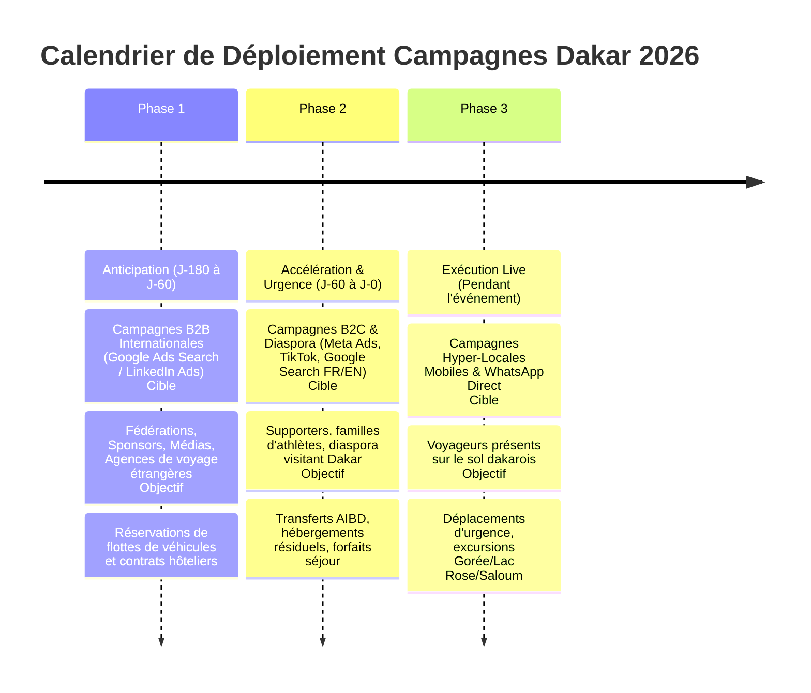

# 16. Plan de Campagne Dakar 2026 : Réceptif et Événement International
**SLAAC Voyages | Anticipation Événementielle, Logistique Terrestre et Conformité Juridique**

---

## 1. Contexte Stratégique et Opportunité Économique

L'accueil à Dakar de l'événement sportif international majeur de 2026 (première édition olympique sur le continent africain) va drainer des dizaines de milliers d'athlètes, délégations, journalistes, partenaires institutionnels, sponsors et touristes internationaux.

Pour SLAAC Voyages, l'enjeu consiste à capter la demande réceptive privée :
1. Mise à disposition de véhicules avec chauffeurs privés bilingues pour les délégations et entreprises.
2. Transferts AIBD haut de gamme et navettes quotidiennes vers les sites de compétition (Dakar, Diamniadio, Saly).
3. Réservations d'hébergements et forfaits séjours combinés (compétition + découverte touristique du Sénégal).

---

## 2. Conformité Juridique et Règles de Propriété Intellectuelle (CIO / COJO)

L'usage des marques olympiques et des anneaux est strictement encadré par le droit international et la législation sénégalaise.

### Règles d'Or Impératives pour SLAAC Voyages :
1. **Zéro Utilisation des Marques Protégées dans les Textes Publicitaires :** Ne jamais employer les termes déposés comme « JOJ Officiel », « Partenaire Officiel », ni les logos olympiques sans licence expresse.
2. **Formulations Neutres et Descriptives Autorisées :**
   - « Séjours & Transferts Dakar Octobre 2026 »
   - « Transport privé pour délégations et médias à Dakar »
   - « Chauffeur et hébergement à Diamniadio et Dakar 2026 »
   - « Réceptif touristique Sénégal 2026 »
3. **Mention de Non-Affiliation Obligatoire (Disclaimer Légal) :**
   Toute page ou communication dédiée doit porter la mention :
   > *« SLAAC Voyages est une agence réceptive privée et indépendante, immatriculée au Sénégal. Elle n'est en aucun cas affiliée ni mandatée par le Comité d'Organisation des Jeux Olympiques de la Jeunesse (COJO) ou le Comité International Olympique (CIO). »*

---

## 3. Déploiement en 3 Phases Temporelles

---

## 4. Ciblage et Architecture de Mots-Clés Dédiés

### Mots-Clés Campagne Internationale FR/EN
- `[private driver dakar 2026]`
- `[dakar 2026 transport delegation]`
- `[hotel transfer dakar diamniadio 2026]`
- `"chauffeur prive dakar diamniadio octobre 2026"`
- `"location van chauffeur dakar 2026"`
- `"agence receptive senegal sejour 2026"`

### Structure des Annonces Dédiées
- **Titre 1 :** Séjours & Transport Dakar 2026
- **Titre 2 :** Chauffeurs Privés & Vans VIP
- **Titre 3 :** Prise en Charge AIBD et Diamniadio
- **Description :** *Organisez la logistique de votre séjour à Dakar pour les grands événements d'octobre 2026. Flotte moderne, chauffeurs bilingues et facturation entreprise avec SLAAC Voyages.*
