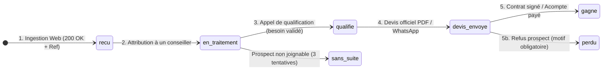

# 17. Processus Opérationnel de Gestion des Leads et SLA CRM
**SLAAC Voyages | Traitement des Demandes, Cycle de Vente et SLAs Réactivité**

---

## 1. La Règle d'Or de la Conversion : La Vitesse de Prise de Contact

Dans l'industrie du voyage et des transferts aéroport, le taux de conversion chute de plus de **391% si le prospect est recontacté après plus d'une heure**. 
L'avantage concurrentiel de SLAAC Voyages repose sur la rapidité et la personnalisation de la prise en charge.

### Engagements SLA (Service Level Agreements)
- **Heures Ouvrées (08h30 - 19h00 Lun-Sam) :** Prise de contact ou accusé de réception personnalisé en **moins de 15 minutes**.
- **Hors Heures Ouvrées & Dimanches :** Réponse automatique immédiate et contact direct sous **2 heures maximum** pour les transferts AIBD urgents du jour même.
- **Délai Maximum d'Émission du Devis Chiffré :** Moins de 2 heures pour un transfert ou un vol sec, moins de 24 heures pour un circuit sur mesure ou un groupe.

---

## 2. Cycle de Qualification et Statuts CRM Firestore

Chaque lead issu du web est stocké dans Firestore dans la collection `quotes` ou `contacts`.

### Grille d'Analyse des Statuts

| Statut Firestore | Action Requise de l'Agent SLAAC | Délai Cible | Déclenchement Tracking |
| :--- | :--- | :--- | :--- |
| `recu` | Réception de l'alerte email + notification dashboard | Instantané (t=0) | `lead_created` |
| `en_traitement` | L'agent s'attribue le dossier et compose le numéro WhatsApp/téléphone | < 15 min | Interne CRM |
| `qualifie` | Validation des 5 critères clés (Dates, Budget, Passagers, Services, Disponibilités) | < 30 min | Interne CRM |
| `devis_envoye` | Envoi du devis PDF chiffré par email et lien de validation WhatsApp | < 2 heures | `quote_step_complete` |
| `gagne` | Enregistrement de la preuve de paiement (Wave, virement, CB, agence) | Selon client | **Google Ads OCI / CAPI Purchase** |
| `perdu` | Saisie obligatoire du motif (Tarif trop cher, Date passée, Concurrent, Autre) | Clôture dossier | Décompte taux de chute |

---

## 3. Matrice de Qualification Téléphonique / WhatsApp (BANT Tourisme)

Lors de la première prise de contact, l'agent SLAAC vérifie systématiquement :
1. **Besoin précis (Need) :** Vol sec, navette aéroport, accompagnement visa, circuit sur mesure, omra.
2. **Calendrier (Timeline) :** Date et heure précises (notamment numéro de vol pour transfert AIBD).
3. **Autorité (Authority) :** Décideur individuel, chef de famille, responsable achats d'entreprise.
4. **Budget (Budget) :** Adéquation avec la grille tarifaire SLAAC (rappel que les transferts AIBD démarrent à 35 000 FCFA péage inclus).
5. **Documents :** Validité du passeport (> 6 mois) et nécessité d'un visa.

---

## 4. Notifications et Flux Transactionnels

1. **Alerte Interne Agence :** Email instantané envoyé à `contact@slaacvoyages.com` et notification push/webhook avec :
   - Référence du dossier (`DV-YYYYMMDD-XXXX`).
   - Nom, téléphone, email du client.
   - Source d'acquisition (`utm_source`, `utm_campaign`, `landing_page`).
   - Service demandé et montant estimé.
2. **Notification Client :**
   - Accusé de réception email automatique bilingue (FR/EN) conforme aux normes du Prompt 09.
   - Message WhatsApp préformaté pour confirmer la prise en charge immédiate.
