# 18. Tableau de Bord Marketing et Pilotage de la Performance Commerciale
**SLAAC Voyages | Métriques en Temps Réel, Attribution Multi-Canaux et Cockpit Décisionnel**

---

## 1. Objectifs du Tableau de Bord de Pilotage

Le tableau de bord marketing de SLAAC Voyages réconcilie les investissements d'acquisition avec les résultats commerciaux tangibles enregistrés dans le CRM.
Il permet à la direction de piloter l'agence à travers un **cockpit unique** accessible dans l'interface d'administration sécurisée (`/admin/statistiques`).

---

## 2. Indicateurs Clés de Performance (KPIs) Suivis

Le cockpit s'organise en 4 couches de données interconnectées :

```mermaid
flowchart LR
    subgraph L1["1. Visibilité & Clarté"]
        A["Impressions Publicitaires"]
        B["Clics Générés"]
        C["Taux de Clic (CTR %)"]
        D["Coût Par Clic (CPC)"]
    end
    subgraph L2["2. Efficacité Web"]
        E["Visites Landing Page"]
        F["Taux de Rebond (< 45%)"]
        G["Ouvertures Devis (quote_start)"]
        H["Taux de Conversion LP (%)"]
    end
    subgraph L3["3. Génération de Leads"]
        I["Leads Enregistrés (lead_created)"]
        J["Clics WhatsApp Qualifiés"]
        K["Coût Par Lead (CPL en FCFA)"]
    end
    subgraph L4["4. Rentabilité Financière"]
        L["Devis Signés / Gagnés (gagne)"]
        M["Taux de Clôture (%)"]
        N["Coût d'Acquisition Client (CPA)"]
        O["Chiffre d'Affaires Réalisé (FCFA)"]
        P["R.O.A.S. (CA / Dépenses Pub)"]
    end

    L1 --> L2 --> L3 --> L4
```



---

## 3. Architecture Technique de l'Endpoint Statistiques

L'API route [src/app/api/admin/statistiques/overview/route.ts](file:///home/mouhammad/zahra-voyages/src/app/api/admin/statistiques/overview/route.ts) a été mise à niveau pour agréger automatiquement :
1. **Les devis par campagne (`campagne` / `utm_campaign`) :** Comptabilisation du volume de dossiers et du montant total en FCFA.
2. **La répartition par canal d'acquisition (`utm_source` / `utm_medium`) :** Google Ads, Meta Ads, TikTok, Référencement Naturel (SEO), Direct, et Réseaux Sociaux Organiques.
3. **Le ratio de conversion par service :** Répartition entre transfert AIBD, billetterie, assistance visa, séjours réceptifs et omra.

### Extrait de la Structure de Réponse JSON

```json
{
  "totalDevis": 142,
  "montantTotal": 14500000,
  "devisGagnes": 38,
  "chiffreAffairesGagne": 8950000,
  "tauxTransformation": 26.76,
  "cplMoyen": 1580,
  "sources": [
    { "source": "google / cpc", "leads": 68, "gagnes": 22, "ca": 5200000 },
    { "source": "facebook / paid_social", "leads": 45, "gagnes": 11, "ca": 2400000 },
    { "source": "tiktok / cpc", "leads": 18, "gagnes": 3, "ca": 750000 },
    { "source": "organic", "leads": 11, "gagnes": 2, "ca": 600000 }
  ],
  "campagnes": [
    { "campagne": "sn_dakar_search_transfert-aibd", "leads": 42, "ca": 1470000 },
    { "campagne": "sn_dakar_search_services-visa", "leads": 18, "ca": 1800000 }
  ]
}
```

---

## 4. Seuils d'Alerte et Tableaux de Bord Visuels

Pour éviter toute dérive de budget ou perte de rentabilité, 3 alertes automatiques sont configurées :
- **Alerte Rouge CPL :** CPL supérieur à `4 500 FCFA` sur une campagne Search active.
- **Alerte Décrochage Conversion :** Taux de conversion Landing Page inférieur à `4.0%` sur 200 visites consécutives.
- **Alerte SLA Traitement Lead :** Tout lead restant au statut `recu` plus de 30 minutes sans prise en charge envoie un rappel par notification à l'équipe.
