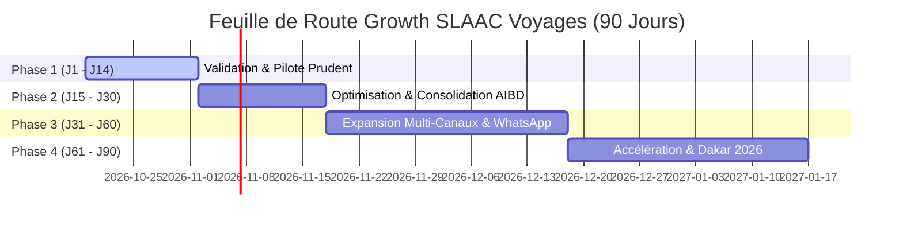

# 20. Feuille de Route d'Acquisition et de Croissance sur 90 Jours
**SLAAC Voyages | Plan d'Exécution Trimestriel, Montée en Charge et Jalons de Rentabilité**

---

## 1. Vue d'Ensemble des 4 Phases de Croissance

---

## 2. Déroulé Opérationnel Détaillé par Phase

### Phase 1 : Jours 1 à 14 — Validation Technique et Pilote Prudent
- **Jours 1 - 3 :**
  - Revue conjointe du tracking avec la direction commerciale SLAAC.
  - Test de bout en bout de la bannière Consent Mode v2 et de l'étanchéité des cookies.
  - Validation des notifications email et de la visibilité des devis dans `/admin/leads`.
- **Jours 4 - 7 :**
  - Obtention de l'autorisation écrite formelle pour le lancement du **Scénario A (50 000 FCFA)**.
  - Configuration du compte Google Ads : Import de la liste partagée de mots-clés négatifs, paramétrage du plafonnement CPC max (250 FCFA).
- **Jours 8 - 14 :**
  - Activation de la campagne pilote `SN_DAK_SEARCH_TRANSFERT-AIBD` vers `/lp/transfert-aibd`.
  - Recette des 10 premiers clics réels et confirmation de la persistance des `gclid` dans Firestore.
  - Objectif : Obtenir les 5 premiers leads réels à un CPL < 2 500 FCFA.

---

### Phase 2 : Jours 15 à 30 — Consolidation, Nettoyage des Requêtes et Premier Test CRO
- **Actions Clés :**
  - Analyse quotidienne du rapport des termes de recherche Google Ads pour exclure les requêtes parasites.
  - Vérification de la bonne déduplication Pixel et CAPI dans le Gestionnaire d'Événements Meta.
  - Lancement du premier test CRO sur `/lp/transfert-aibd` : Mise en avant du badge « Péage autoroute inclus ».
  - Première session de formation des conseillers agence au respect du SLA de rappel en moins de 15 minutes.
- **Livrables :** Premier rapport hebdomadaire consolidé et ajustement des enchères aux heures de pointe d'atterrissage à l'AIBD (vols de nuit et début d'après-midi).

---

### Phase 3 : Jours 31 à 60 — Expansion Multi-Canaux et Bascule au Scénario B (150 000 FCFA)
- **Actions Clés :**
  - Activation de la campagne Meta Ads Click-to-WhatsApp ciblée sur les commerçants de Dakar (Visa Chine & Billetterie).
  - Lancement de la campagne Google Search Billetterie (`SN_DAK_SEARCH_BILLETTERIE-VOLS`).
  - Déploiement de la Landing Page d'assistance visa.
  - Automatisation de l'export des devis gagnés pour l'import des conversions hors ligne dans Google Ads.
- **Indicateur Cible :** Atteindre un rythme de croisière de 3 leads qualifiés par jour avec un panier moyen supérieur à 60 000 FCFA.

---

### Phase 4 : Jours 61 à 90 — Accélération Commerciale, TikTok Ads et Amorçage Dakar 2026
- **Actions Clés :**
  - Lancement des tests de vidéos courtes verticales (9:16) sur TikTok Ads (Format Spark Ads & Lead Gen).
  - Lancement de la Phase 1 d'anticipation pour **Dakar 2026** (Ciblage B2B international, fédérations sportives, entreprises partenaires, avec mention légale obligatoire de non-affiliation).
  - Évaluation de l'opportunité de bascule vers le **Scénario C (300 000 FCFA / mois)** conditionnée à un ROAS constaté supérieur à 10x.
  - Bilan trimestriel complet présenté au comité de direction de SLAAC Voyages.
