# Rapport 02 : Architecture Cible de l'Administration
## SLAAC Voyages | Prompt 11/12

### 1. Vision et Principes Directeurs
L'architecture cible transforme le back-office en un ERP/CRM moderne, modulaire, sécurisé et scalable pour SLAAC Voyages. Les principes directeurs appliqués sont :
1. **Défense en Profondeur** : Contrôle systématique en couche présentation (UI), en couche applicative (Server Actions / Next.js API Routes), et en couche de données (Règles Firestore).
2. **Principe du Moindre Privilège** : Chaque collaborateur n'accède qu'aux écrans et actions strictement nécessaires à sa fonction quotidienne.
3. **Séparation Découplée des Préoccupations (SoC)** : Séparation claire entre la logique métier (`src/lib/*`), les interfaces API (`src/app/api/admin/*`), et les composants de restitution (`src/app/admin/(protected)/*`).

### 2. Vue d'Ensemble des Modules Applicatifs
L'application d'administration est structurée en 6 grands domaines fonctionnels :

```mermaid
graph TD
    A[Super Admin & Direction] --> B[Gestion des Utilisateurs & Rôles]
    A --> C[Tableau de Bord & KPIs Financiers]
    A --> D[Audit Logs & Sécurité]

    E[Pôle Commercial & Opérations] --> F[CRM Prospects & Leads]
    E --> G[Dossiers de Voyage - Travel Files]
    E --> H[Propositions Commerciales & Devis PDF]
    E --> I[Tâches Collaborateurs & Relances]

    J[Pôle Contenu & SEO] --> K[Catalogue Voyages & Packages]
    J --> L[Destinations & Guides Tourisme]
    J --> M[Métadonnées SEO & Balisage]

    N[Pôle Marketing] --> O[Attribution & Suivi des Campagnes]
    N --> P[Conversions & Analyse ROI]

    Q[Système & Communications] --> R[Supervision Outbox Email]
    Q --> S[Coffre-fort Documentaire Privé]
```

### 3. Schéma des Données Firestore
Les collections Firestore ont été normalisées pour éliminer toute redondance et garantir des requêtes optimisées :
- `admin_users` : Profils collaborateurs, rôles RBAC, permissions personnalisées et état d'activité.
- `clients` : Annuaire unifié des clients avec dédoublonnage par téléphone/email et historique d'achats.
- `travel_files` : Dossiers de voyage complets suivant le cycle de vie opérationnel (référence `DV-DOS-YYYYMMDD-XXXX`).
- `proposals` : Devis et propositions commerciales chiffrées en FCFA (référence `DV-PROP-YYYYMMDD-XXXX`).
- `team_tasks` : Tâches assignées aux agents avec priorités, échéances et liaisons de dossiers.
- `admin_audit_logs` : Journal d'audit inviolable consignant chaque événement administratif critique.
- `email_outbox` / `notifications` : Traçabilité des envois d'emails et gestion des états de remise.

### 4. Robustesse et Évolutivité
L'architecture Next.js 15 App Router avec Server Components et API Routes typées TypeScript garantit un temps de réponse rapide, une tolérance aux pannes élevée et une évolutivité sans friction pour les futurs déploiements.
