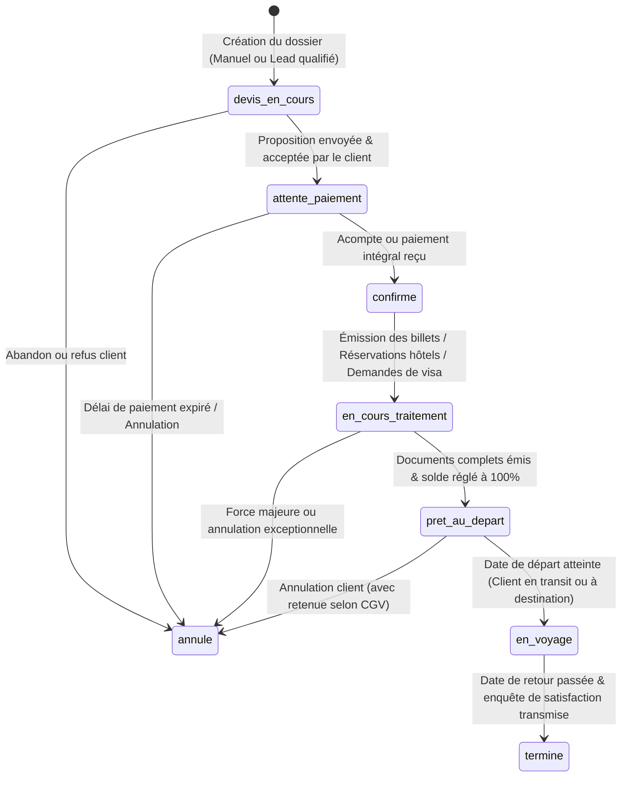
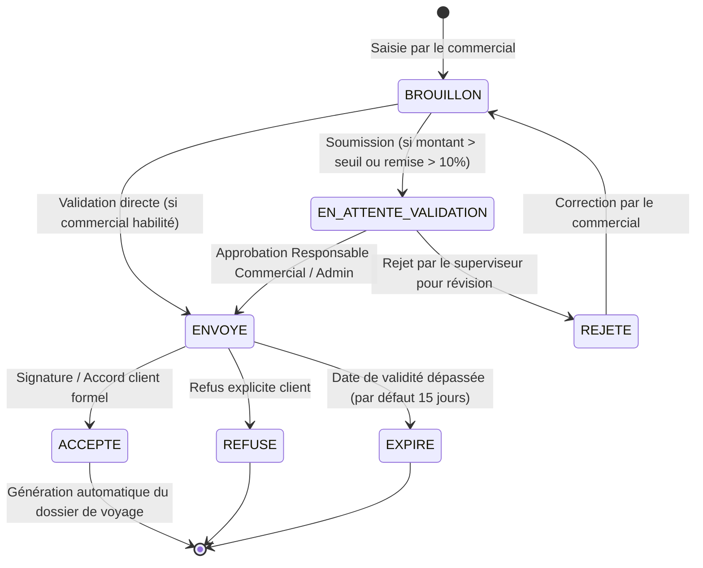
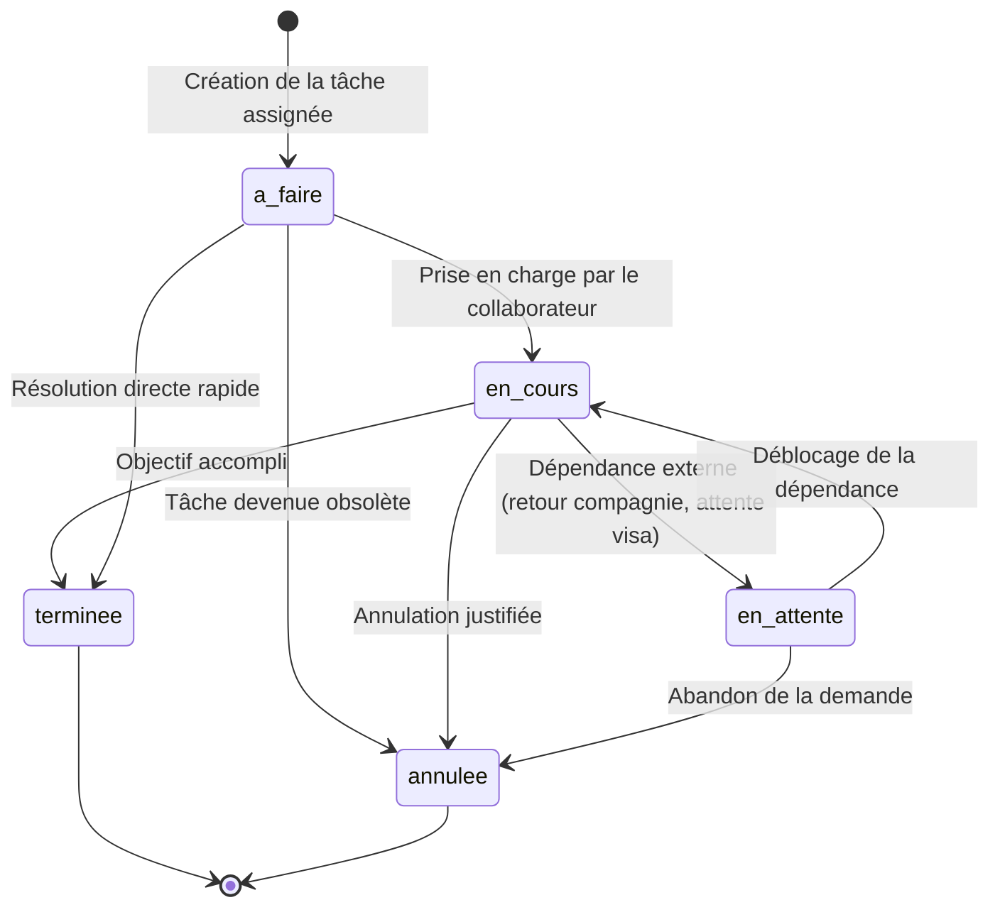

# Machines à États et Workflows Opérationnels SLAAC Voyages
## Prompt 11/12 — Architecture des Transitions d'États

Ce document spécifie les automates à états finis (FSM) pour l'ensemble des entités métier gérées dans l'administration de SLAAC Voyages : **Dossiers de Voyage**, **Propositions Commerciales (Devis)**, et **Tâches Collaborateurs**.

---

### 1. Machine à États : Dossiers de Voyage (`travel_files`)

Le cycle de vie d'un dossier de voyage reflète rigoureusement le traitement opérationnel d'une commande client, depuis la demande initiale jusqu'au retour de voyage et à la clôture du dossier.

#### Règles de Transition :
1. **`devis_en_cours` $\rightarrow$ `attente_paiement`** : Exige la présence d'au moins un devis lié avec un montant total validé.
2. **`attente_paiement` $\rightarrow$ `confirme`** : Nécessite l'enregistrement d'un justificatif financier (acompte minimum ou règlement total).
3. **`en_cours_traitement` $\rightarrow$ `pret_au_depart`** : Tous les vouchers indispensables (billetterie, réservation d'hébergement, visas) doivent être attachés au dossier.
4. **`en_voyage` $\rightarrow$ `termine`** : Clôture définitive du dossier avec archivage de l'historique et envoi du feedback client.

---

### 2. Machine à États : Devis & Propositions Commerciales (`proposals`)

#### Invariants Financiers :
- **Calcul en FCFA** : Tout calcul financier repose sur des entiers stricts (pas d'arrondis centimes erronés).
- **Formule stricte** : $\text{Total TTC} = (\text{Total HT} - \text{Remise}) + \text{Total Taxes}$.
- **Immuabilité** : Dès qu'une proposition passe au statut `ENVOYE` ou `ACCEPTE`, son contenu chiffré devient strictement immuable (lecture seule). Toute modification impose la création d'un avenant ou d'une nouvelle version (V2).

---

### 3. Machine à États : Tâches d'Équipe & Relances (`team_tasks`)

#### Traçabilité & Alertes :
- **Échéance dépassée** : Si la date du jour est strictement supérieure à `dueDate` et que le statut est différent de `terminee` ou `annulee`, la tâche passe automatiquement en drapeau rouge visuel (**En retard**).
- **Audit des changements** : Tout changement de statut ou de collaborateur assigné déclenche un enregistrement dans le journal d'audit immuable (`admin_audit_logs`).
